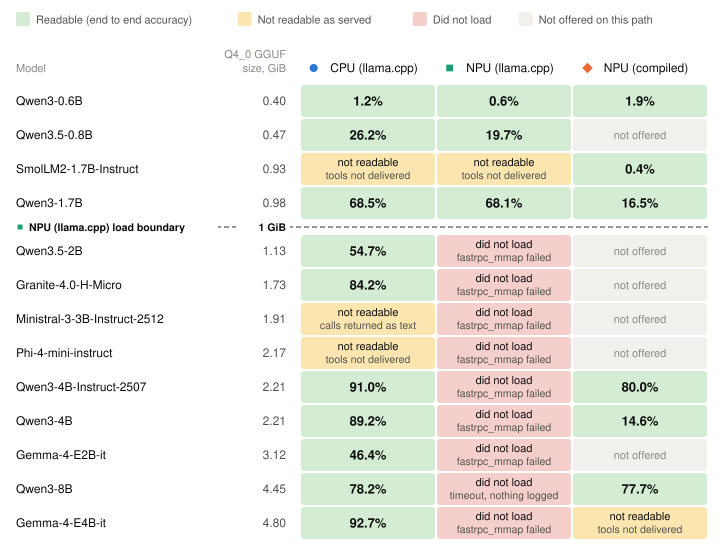

# edge-agent-bench

An open benchmark for small language models acting as tool-calling agents on
the device, measured through the serving stack the device ships with, on the
CPU and on the NPU.

Most tool-calling benchmarks score a model through a vendor API or a GPU
server, and their own code renders the prompt and parses the reply. On a
device, an agent sends its tool definitions to a local server and reads back
whatever structured call that server returns. edge-agent-bench grades exactly
that: the `tool_calls` field returned by the deployed server, for each model on
each serving path, together with the time each agent turn takes. The serving
path is a variable of the benchmark, not a fixed backdrop.

## Version 2 results (Qualcomm QCS9075, October 2026)

Version 2 measured 13 small models from Qualcomm AI Hub release 0.64.0 on a
Qualcomm Dragonwing IQ-9075 EVK (QCS9075) through one server binary, GenieX
v0.8.0, on up to three serving paths: llama.cpp on the CPU, the same GGUF file
on the Hexagon NPU through llama.cpp, and Qualcomm AI Hub bundles compiled for
the NPU. Each configuration answered 390 single-turn requests of about 2,700
prompt tokens offering four tools. The full report, with every caveat, is
[docs/REPORT.md](docs/REPORT.md).

The serving stack, not the model, decided 14 of the 33 planned model and path
steps. Nine models did not load on the llama.cpp NPU path, four configurations
never received the tool definitions, and one model's correct calls came back as
text. The configurations whose scores can be read as model capability include
these:

| Model | Path | End to end, % (95% CI) | Median agent turn, s |
|---|---|---|---|
| Gemma-4-E4B-it | CPU (llama.cpp) | 92.7 (89.5-95.5) | 49.73 |
| Qwen3-4B-Instruct-2507 | CPU (llama.cpp) | 91.0 (87.4-94.2) | 52.93 |
| Qwen3-4B | CPU (llama.cpp) | 89.2 (85.4-92.7) | 53.03 |
| Granite-4.0-H-Micro | CPU (llama.cpp) | 84.2 (79.7-88.5) | 35.16 |
| Qwen3-4B-Instruct-2507 | NPU (compiled) | 80.0 (75.0-84.6) | 6.71 |
| Qwen3-8B | NPU (compiled) | 77.7 (72.7-82.7) | 9.74 |
| Qwen3-1.7B | NPU (llama.cpp) | 68.1 (62.3-73.7) | 5.25 |

Every configuration above 85% ran on the CPU, where the three leaders cannot
be separated at this suite size. The most accurate NPU configuration, the
compiled Qwen3-4B-Instruct-2507 bundle, scored 11.0 percentage points below the
same model on the CPU, for a turn about 7.9 times shorter. Moving a GGUF from
the CPU to the NPU did not measurably change Qwen3-1.7B's accuracy, while
compiled bundles changed accuracy by an amount that depends on the model; for
two Qwen3 bundles most failures are text tool calls one closing brace short.
The server re-read the whole prompt on every request, so the NPU's advantage in
agent-turn time holds for requests without prompt-prefix reuse.

All numbers are scoped to this board, GenieX v0.8.0, this four-tool
single-turn suite and October 2026. Later GenieX releases were not measured.

## Repository layout

| Directory | Contents |
|---|---|
| harness/ | bench_toolcall.py (tool-calling benchmark), phase_probe.py (prefill and decode throughput), bench_tools_in_prompt.py (a diagnostic that writes the tools into the system prompt), bench_sampling.py (adds sampling fields such as top_k to every request), soak_npu.py (sustained load), harness_selftest.py |
| suites/ | 65 canonical cases, 195 paraphrases, the 12-tool schema in nested and flat form, and a README with the labelling and grading rules |
| campaign/ | run_campaign.py, the resumable runner; v2_models.json, the model list; and v2_followup.json, the phases of the follow-up on a later GenieX release |
| results/ | v2/, the version 2 results with their provenance, and the version 1 directories (2026-09) |
| analysis/ | analyze.py (base statistics), report.py and its modules (every number in the report), figures.py, data/ and out/ (the generated tables) |
| docs/ | REPORT.md, METHODOLOGY.md, THERMAL.md, PROPOSAL.md (project history) and figures/ |
| scripts/ | import_results.py (copies raw results into the repository without lab details), leak_scan.py, and the version 1 run scripts |

## Running the benchmark

The code needs Python 3 (tested with 3.12) and PyYAML, and otherwise only the
standard library. The self-test runs the harness against a local fake server
and needs no device:

    python3 harness/harness_selftest.py

A canonical run against any OpenAI-compatible chat endpoint, such as a
llama.cpp server, GenieX, vLLM or Ollama, looks like this:

    python3 harness/bench_toolcall.py --url http://HOST:PORT --model MODEL \
      --tools-file suites/tools_nested.json \
      --tool-subset "query_device_info,configure_device_setting,diagnose_port_issues,search_documentation" \
      --cases suites/test_cases.yaml --repeats 3 --warmup 1 \
      --out results/MODEL-canonical.json

The paraphrase run uses `--cases suites/test_cases_paraphrase.yaml --repeats 1`.
Keep the four-tool subset: without it the harness offers all 12 tools, which do
not fit beside an answer in a 4,096-token context. Adding `--board-ssh
USER@BOARD --readiness` records the board's provenance, waits for it to be
cool and idle before each repetition, and samples its temperatures throughout
the run.

The throughput probes time each streamed token at agent-like prompt lengths
and at a chat-like shape:

    python3 harness/phase_probe.py --url http://HOST:PORT --model MODEL \
      --lengths 256,512,1024,2048,2800 --gen-tokens 128 --repeats 5 --warmup 1 \
      --method stream --out results/MODEL-probe-agent.json

For a model with a reasoning mode, pass
`--extra-json '{"enable_think": false, "chat_template_kwargs": {"enable_thinking": false}}'`
to the probe; the tool-calling harness switches reasoning off by default.
`python3 analysis/analyze.py <results dir> --md out.md --json out.json` then
summarises any directory of result files, with bootstrap intervals and paired
tests.

## Checking a deployment before comparing models

Two checks would have caught every configuration in version 2 whose score says
nothing about the model. The first compares the server-reported prompt token
count (`usage.prompt_tokens`) for the same request with and without the tools:
if the counts are close, the server dropped the tools. The second counts the
share of replies that carry a structured call: if it is near zero while the
replies contain call-like text, the server is not parsing the model's call
format. Section 12 of the report lists all ten failure modes the campaign met,
each with an automatic check.

## Reproducing the report

Every table and figure in the report is regenerated from results/v2 alone:

    python3 analysis/report.py results/v2 --json analysis/out/report.json --md analysis/out/report_tables.md
    python3 analysis/figures.py analysis/out/report.json docs/figures

The report is also available as a single HTML page with its figures embedded,
[docs/report.html](docs/report.html), which `python3 scripts/report_html.py`
rebuilds from docs/REPORT.md (this step also needs the Python-Markdown package).

[results/v2/README.md](results/v2/README.md) describes every result file, and
[docs/METHODOLOGY.md](docs/METHODOLOGY.md) the protocol, the statistics and the
provenance each file records. Section 17 of the report lists the hashes a rerun
must match.

## Versions

Version 2 (October 2026) is the current campaign and the subject of the
report. Version 1 (September 2026) measured three models on the same board
with mixed server versions; its report was never published, its results remain
under results/2026-09-*/, and Section 14 of the version 2 report gives the
status of each of its findings.

## Citing

Krish (2026). edge-agent-bench: tool calling through the deployed server on a
Qualcomm QCS9075, version 2.

## License

Apache-2.0 (see [LICENSE](LICENSE)). Copyright 2026 Krish.
