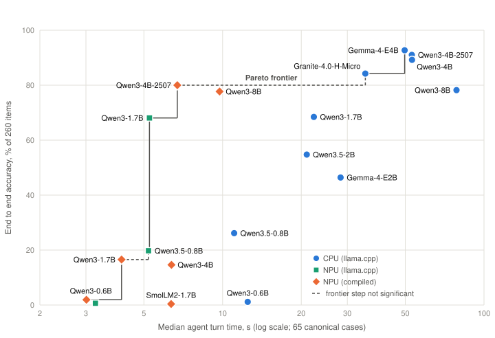
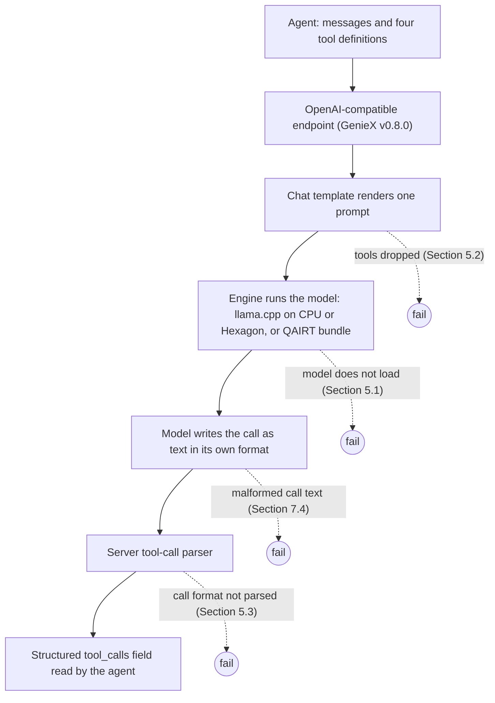
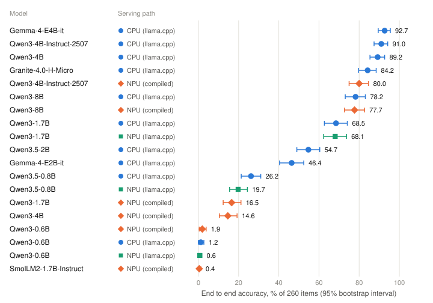
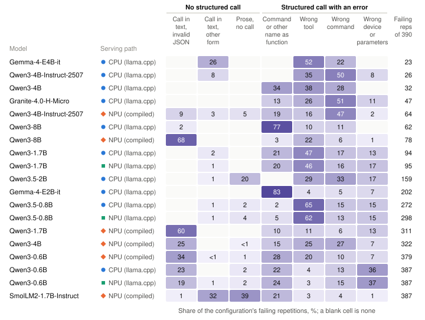
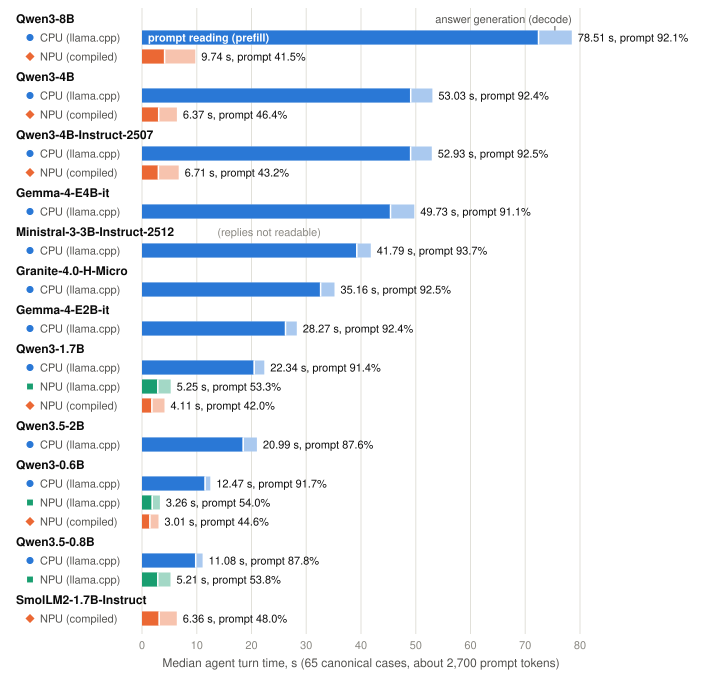
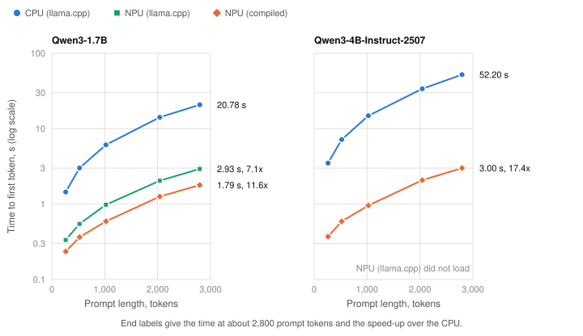
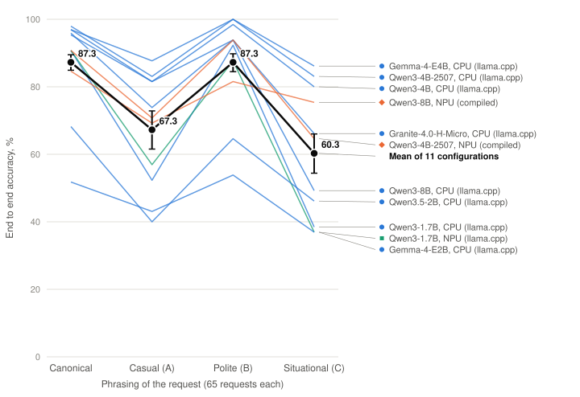

# Tool calling through the deployed server on a Qualcomm QCS9075: 13 small models on three serving paths under GenieX v0.8.0

*edge-agent-bench, version 2. Qualcomm QCS9075 (Dragonwing IQ-9075 EVK), GenieX v0.8.0, measured 2026-10-14 to 2026-10-17.*

Krish, 2026-10-18

All measurements were taken on one Qualcomm Dragonwing IQ-9075 EVK [1] (QCS9075, Qualcomm Linux 1.6, fan cooled) through GenieX v0.8.0 [2] (QAIRT 2.45, llama.cpp 9425611), Qualcomm's public OpenAI-compatible model server. It runs a model through llama.cpp on the CPU, through llama.cpp's Hexagon NPU backend, or as a Qualcomm AI Hub bundle compiled for the NPU, each with a 4,096-token context. The 13 models come from Qualcomm AI Hub release 0.64.0 [3], checked 2026-10-14. The campaign ran from 2026-10-14 to 2026-10-17, for 62.69 board hours of serving (Appendix D). Requests are single-turn, offer four tools, carry about 2,700 prompt tokens where the tools were delivered, ask for temperature 0 and switch reasoning off. Every figure carries this scope unless the text narrows it; Section 14 compares version 1 (2026-09).

## Abstract

Can a small model, served on the device through the vendor's serving stack, drive a tool-calling agent? Thirteen catalog models ran on a QCS9075 through GenieX v0.8.0 on up to three paths: one llama.cpp model file (GGUF) on the CPU and on the NPU, and NPU bundles compiled ahead of time. The 24 configurations that loaded each answered 390 single-turn requests offering four tools. The serving stack, not the model, decided 14 of 33 planned steps: nine models did not load on the llama.cpp NPU path, two GGUF templates and a compiled prompt builder dropped the tools, and one model's calls came back as text. Three models reach 89.2 to 92.7% on the CPU at about 50 s per turn and cannot be ordered; only the two Qwen3-4B models among them could be scored on an NPU path. The best NPU configuration, compiled Qwen3-4B-Instruct-2507, scores 80.0% (95% CI 75.0 to 84.6) at 6.71 s per turn, 11.0 percentage points (pp) below its CPU run for a turn 7.9 times shorter. GenieX v0.8.0 re-read the whole prompt on every request (0 of 9,360 reused a prefix); a model of prefix reuse, not a measurement, cuts that speed-up to 1.22 to 1.51. For a chat-shaped turn the NPU paths ran models up to 1.7B at 0.42 to 0.88 times CPU speed. The same GGUF on the NPU scored Qwen3-1.7B within 0.4 pp of the CPU, and Qwen3.5-0.8B's 6.4 pp loss did not survive Holm correction. Compiled bundles scored significantly below the CPU GGUF for three of five Qwen3 models; for compiled Qwen3-1.7B and Qwen3-8B most failures are text tool calls one closing brace short. Rephrasing cost the 11 configurations with at least 50% on canonical requests 15.7 pp on average, and temperature 0 did not give repeatable replies on the llama.cpp paths. A later check under GenieX v0.9.3 found 10 of the 14 stack-decided steps still decided by the stack (Section 18).

## How to read this report

The wording separates four kinds of statement: "measured" marks a direct observation, "suggests" or "is consistent with" an inference from measurements, "a hypothesis" a mechanism that was not verified, and "a model, not a measurement" the one generated table that computes what would happen under conditions that were not run. Intervals are 95% unless stated otherwise, pp means percentage points, and every Holm-adjusted p value names the size of its family (Table B1). Ranges are written with "to"; tables keep the generated form with a hyphen.

The serving paths are labelled CPU (llama.cpp), NPU (llama.cpp) and NPU (compiled), as in the figures; in running text "compiled" alone means NPU (compiled). A configuration is one model on one serving path, and a planned model-path step is a configuration the campaign set out to run. The serving stack decided a step when its outcome says nothing about the model: the model did not load, its prompts lacked the tools, or its calls came back as text. A configuration is readable when its prompts carried the tools and its replies were not mostly calls returned as text (exact rule in Section 3.7). An item is one canonical case, scored as its pass fraction over three repetitions, or one paraphrase; the pooled score is the mean over 260 items. The functional pool is the 11 readable configurations with canonical accuracy of at least 50%. Appendix I defines the remaining terms.

Every number comes from analysis/out/report_tables.md, which analysis/report.py generates from results/v2, or from arithmetic on it that the text shows; the numbers of the addendum (Section 18) come from analysis/out/followup_tables.md, generated from results/v2-followup. Names in italics, such as *Agent turn time*, are section headings of that file, and each numbered table names its source. Appendix H links each one.

## 1. What works, what it costs and what to check

On this board and server, the most accurate tool calling ran on the CPU, at about 50 s per agent turn; every NPU configuration whose score could be read took 3.01 to 9.74 s per turn, at a cost in accuracy; and before any model could be compared, the serving stack decided 14 of the 33 planned model-path steps (Section 4).

Nine GGUFs did not load on NPU (llama.cpp): under GenieX v0.8.0 defaults every GGUF up to 0.98 GiB loaded and none from 1.13 GiB up did, and the mechanism is unresolved (Section 5.1). Four configurations never received the tool definitions (Section 5.2), and the server returned every call of Ministral-3-3B-Instruct-2512 as text; graded from the text, its calls would score 91.5%, a diagnostic, not a result (Section 5.3). The compiled Gemma-4-E4B-it scored 0.0% even with the tools written into its prompt, against 92.7% for its CPU GGUF, which suggests a further defect on that path. Later GenieX releases include changes aimed at the load failures and at the compiled Gemma bundle's dropped tools; the campaign did not measure them, and Section 18 reports a later check under v0.9.3, in which four of the nine models load on NPU (llama.cpp) and the compiled Gemma bundle receives its tools but stops calling them once its prompt passes roughly 900 to 1,600 tokens.


**Figure 1.** What the serving stack let through under GenieX v0.8.0. Readable cells give pooled accuracy over 260 items; other cells give the reason the score cannot be read, the load failure, or that no bundle is offered. Rows are ordered by GGUF size, and the dashed line marks 1 GiB, between Qwen3-1.7B (0.98 GiB) and Qwen3.5-2B (1.13 GiB). The source is *Coverage of the planned model and path steps*.

Every configuration above 85% runs on the CPU, where Gemma-4-E4B-it (92.7%), Qwen3-4B-Instruct-2507 (91.0%) and Qwen3-4B (89.2%) cannot be separated: at this suite size a difference between neighbours would need about 6 pp to be detected with 80% power, or about 9 pp at the strictest Holm threshold (Section 6.1). Only the two Qwen3-4B models among them had a readable NPU configuration, both compiled (80.0% and 14.6%), so the CPU's lead is partly a statement about which models the NPU paths could serve under GenieX v0.8.0.

The most accurate NPU configuration, the compiled Qwen3-4B-Instruct-2507 bundle, scores 80.0% (75.0 to 84.6) at 6.71 s per turn. That is 11.0 pp below the same model on the CPU (Holm p 0.00057, family of 14), for a turn that, paired by case, is a median 7.92 times shorter (Tables 8 and 11). These turn times include a full read of the prompt on every request, as GenieX v0.8.0 performed in all 9,360 graded requests, although most of the prompt is tool definitions that repeat unchanged from turn to turn. Under a model of prefix reuse, not a measurement, the CPU leaders' turns would fall to 4.70 to 6.07 s and this pair's ratio of median turns from the measured 7.89 to 1.22 to 1.51 (Section 8), so a deployment whose server reuses the prompt prefix should measure the paths again. The compiled Qwen3-8B (77.7%) cannot be separated from the Instruct-2507 bundle and is slower, at 9.74 s. The lowest point estimate of seconds per correct action, the median turn divided by accuracy, is 7.71 s, for Qwen3-1.7B on NPU (llama.cpp) at 68.1% and 5.25 s per turn, not separable from the 8.39 s of the compiled Qwen3-4B-Instruct-2507 (Section 9).



**Figure 2.** Pooled accuracy against median agent turn time, without prompt-prefix reuse, for the 19 readable configurations. For a given turn-time budget, the highest point to its left is the most accurate configuration within it. The staircase joins the configurations that no other beats on both measures; its dashed steps are not significant (Section 9). The source is *Accuracy against turn time, and seconds per correct action*.

The same Qwen3-1.7B GGUF scores 68.5% on the CPU and 68.1% on NPU (llama.cpp), a paired difference of -0.4 pp (-2.7 to +1.9), the only informative comparison on this path, since larger GGUFs did not load. For Qwen3.5-0.8B the NPU (llama.cpp) score is 6.4 pp lower (-11.9 to -0.8; Holm p 0.089, family of 14), not significant after correction. Compiled bundles score significantly lower than the CPU GGUF for three of the five Qwen3 models, by 11.0 to 74.6 pp, and no difference was detected for Qwen3-8B (-0.5 pp) or for Qwen3-0.6B, at the floor. For compiled Qwen3-1.7B and Qwen3-8B, most failures are tool calls written as text (60.1% and 67.9%), almost all of them one closing brace short; why the brace goes missing is a hypothesis (Section 7.4).

Reading the prompt takes 87.6 to 93.7% of a CPU agent turn (per-request medians for the 11 CPU configurations whose prompts carried the tools). Paired by case, the median ratio of the CPU turn to the NPU turn is 2.14 to 8.32, but for a chat-shaped turn the NPU paths ran models up to 1.7B at 0.42 to 0.88 times the CPU's speed, because their decode is no faster (Section 8).

Rephrasing cost the functional pool a mean of 15.7 pp (12.2 pp with alternative answers accepted on 12 labels flagged as debatable after the outputs were seen); polite rewrites cost nothing measurable, casual and situational ones 20.0 and 27.0 pp (Section 10).

On the CPU, Qwen3-8B scores 11.0 and 12.8 pp below the two 4B models (Holm p 0.0026 and below 0.001, family of 105), mostly because on paraphrases it calls a command name as the tool, an error its compiled bundle makes in 0.8% of items against 17.4% for this self-quantised GGUF, so the result describes these artifacts rather than model size (Section 6.3).

At temperature 0, 58.0% of canonical cases on the CPU and 33.1% on NPU (llama.cpp) gave identical replies in all three repetitions, against 94.3% on compiled bundles. The gap between the llama.cpp paths is consistent with which models loaded, since for the same GGUF neither path was consistently more repeatable, and the variation sits mainly in the weaker models: the three CPU leaders changed grade in at most 5 of 65 canonical cases, Qwen3.5-2B on the CPU in 31. The mechanism is not established (Section 11).

**Table 1.** Measured options and their costs, with 95% item intervals and median times over the 65 canonical cases, without prefix reuse; seconds per correct action is a ratio, not an observed time (Section 9). The sources are *Accuracy by configuration* and *Accuracy against turn time, and seconds per correct action*.

| Model | Path | End to end, % (item CI) | Canonical, % | Paraphrase, % | Median turn, s | Seconds per correct action |
|---|---|---|---|---|---|---|
| Gemma-4-E4B-it | CPU (llama.cpp) | 92.7 (89.5-95.5) | 96.9 | 91.3 | 49.73 | 53.65 |
| Qwen3-4B-Instruct-2507 | CPU (llama.cpp) | 91.0 (87.4-94.2) | 97.9 | 88.7 | 52.93 | 58.15 |
| Qwen3-4B | CPU (llama.cpp) | 89.2 (85.4-92.7) | 96.9 | 86.7 | 53.03 | 59.43 |
| Granite-4.0-H-Micro | CPU (llama.cpp) | 84.2 (79.7-88.5) | 95.4 | 80.5 | 35.16 | 41.74 |
| Qwen3-4B-Instruct-2507 | NPU (compiled) | 80.0 (75.0-84.6) | 90.8 | 76.4 | 6.71 | 8.39 |
| Qwen3-8B | NPU (compiled) | 77.7 (72.7-82.7) | 84.6 | 75.4 | 9.74 | 12.53 |
| Qwen3-1.7B | NPU (llama.cpp) | 68.1 (62.3-73.7) | 90.8 | 60.5 | 5.25 | 7.71 |

Besides the 14 steps the stack decided, several configurations did not work as served: compiled Qwen3-4B, the hybrid-reasoning 4B rather than the Instruct-2507 release (14.6%), and compiled Qwen3-1.7B (16.5%); Qwen3-0.6B on every path (0.6 to 1.9%); and the compiled SmolLM2-1.7B-Instruct (0.4%), whose prompts did carry the tools.

The results do not cover other boards or server releases, prompt-prefix reuse, multi-turn sessions, energy or memory. Two checks would have caught every unreadable configuration in this campaign before any model comparison: the server-reported prompt token count with and without the tools, and the share of replies that carry a structured call (Section 12).

## 2. Background for readers new to NPUs

### 2.1 How a tool call travels

An agent sends its messages and tool definitions to an OpenAI-compatible endpoint on the device. The server renders them into one prompt through the model's chat template, a small program shipped with the model, and the engine runs the model on that prompt. The model writes its tool call as text in its own format, and the server's tool-call parser turns that text into the structured `tool_calls` field of the response, which is all an agent reads. Each link can fail on its own: a server can drop the tools while rendering the prompt, or fail to recognise a correct call, and a benchmark that renders prompts and parses replies itself sees neither failure. This benchmark therefore grades the structured field returned by the deployed server; Diagram A marks the four places where the campaign observed failures.



**Diagram A.** One request from the agent to the structured tool call, with the four points where the campaign observed failures and the sections that give the evidence.

### 2.2 Prefill and decode

A language model answers in two phases. Prefill reads the whole prompt at once, in parallel, and ends when the first output token is ready; its duration is the time to first token. Decode then writes the answer one token at a time, rereading the model's weights at each step, so it is usually limited by memory traffic rather than arithmetic. For Qwen3-4B-Instruct-2507 the time to first token rises from 3.50 s at 261 prompt tokens to 52.20 s at 2,795 on the CPU, against 0.37 s to 3.00 s compiled (Figure 6). Prefill is much faster on the NPU; decode is about as fast as on the CPU for the compiled Qwen3 models from 4B to 8B and slower for models up to 1.7B. That pattern explains most of the speed results in Section 8.

### 2.3 Why prompt length matters for agents

The tool definitions are most of every agent prompt: Gemma-4-E4B-it's median canonical prompt is 2,821 tokens where the tools were rendered and 601 where they were not (*Tools delivered to the model*), while an answer runs to a few dozen tokens. Where prefill is slow, reading the prompt therefore dominates an agent turn, and writing the answer a chat turn of about 100 tokens in and 300 out. Keeping the computed state of a prompt prefix that repeats across requests, called prefix caching, avoids re-reading it; Section 8 shows that no request reused a prefix.

### 2.4 Three paths, one binary, two weight formats

As Table 2 sets out, CPU (llama.cpp) runs a GGUF file, the llama.cpp model format, on the CPU cores. NPU (llama.cpp) runs the same file through llama.cpp's Hexagon backend, which its upstream introduction calls experimental [5c], for the operations it supports; this is GenieX's default `npu` setting, which its documentation describes as pinned to the first tensor processor, HTP0 (Section 2.5). GenieX also offers a `hybrid` setting that schedules each operation between the NPU and the CPU, which its documentation calls the fast path on Snapdragon; it was not measured [2]. NPU (compiled) runs a Qualcomm AI Hub bundle compiled ahead of time for QAIRT, Qualcomm's AI runtime. A bundle holds 2 to 5 context binaries, precompiled graphs with fixed shapes, here for a 4,096-token context (*Artifacts*). The board's GPU was not used, because GenieX's GPU path is publicly reported to fail on it under v0.8.0 (Section 15); under v0.9.3 it did not load the two models tried (Section 18).

Q4_0, the GGUF format of both llama.cpp paths, stores weights as 4-bit integers in small blocks that share one scale; W4A16, the bundle format, stores 4-bit weights and computes with 16-bit activations. The GGUFs were also quantised in different ways (Table 3); the two Gemma 4 files, for instance, are Google's quantisation-aware-trained releases [6]. Comparisons between models on the llama.cpp paths therefore also compare quantisation recipes, and a GGUF against its compiled bundle also crosses Q4_0 against W4A16 and the prompt rendering.

**Table 2.** The three serving paths, all served by the same GenieX v0.8.0 binary. The sources are docs/METHODOLOGY.md, *Artifacts*, *Tools delivered to the model* and *Provenance*.

| Path | Engine | Artifact and format | Compute unit | How the prompt is built | Context, tokens | Models offered |
|---|---|---|---|---|---|---|
| CPU (llama.cpp) | llama.cpp 9425611 inside GenieX | GGUF, Q4_0 | CPU cores | the GGUF's chat template | 4,096 | 13 |
| NPU (llama.cpp) | llama.cpp 9425611, Hexagon backend | the same GGUF, Q4_0 | Hexagon NPU (one tensor processor) | the GGUF's chat template | 4,096 | 13 |
| NPU (compiled) | QAIRT 2.45 | AI Hub context-binary bundle, W4A16 | Hexagon NPU (one tensor processor) | the bundle's Jinja template; for Gemma-4-E4B-it, the vision pipeline's prefix and suffix table | 4,096 | 7 |

### 2.5 The Hexagon NPU

The NPU of this chip is built from Hexagon tensor processors (HTP), which the CPU drives through FastRPC, a remote-call mechanism with shared-memory mappings. Before the llama.cpp backend can run a model on one, it must map the weights, the key-value cache (the stored attention state of the prompt) and its compute buffers into the processor's address space; the load failures of Section 5.1 occur at that step. The public product documentation lists two tensor processors on this system on chip [7], [8], and each measured NPU configuration used one: every compiled bundle's configuration file requests a single core, and the llama.cpp NPU server logged "Using 1 device(s): HTP0". Platform figures for the whole chip therefore do not describe the compute any configuration used, and this report quotes none.

## 3. The question, the setup and how it was measured

### 3.1 The question

Can a small model, served on the device through the vendor's serving stack, make the structured tool calls an agent needs, and what does each serving path cost in accuracy and in seconds per turn? The established tool-calling benchmarks, of which BFCL is the most widely used, run models through vendor APIs or on GPU servers, and for local models their own harness renders the prompt and parses the reply [9], [10]. The closest on-device LLM benchmarks, Pipette and the Artificial Analysis mobile set, measure speed on the device but take quality from runs elsewhere, and neither includes an NPU path [11], [12]. Two of the failures in Section 5 could not appear in a harness that renders the prompt and parses the reply itself (Section 16).

### 3.2 Contributions

The report contributes an open harness that grades the structured call returned by the deployed server and separates stack failures from model failures (Section 3.7), evidence that the stack decided 14 of 33 planned steps on one server release (Sections 4 and 5), a path comparison that separates moving a GGUF to the NPU from compiling a bundle (Section 7), and a decomposition of agent turn time (Section 8).

### 3.3 The task

The agent operates a managed PoE switch. Every request carries one neutral system prompt, one user message and four tools, `query_device_info`, `configure_device_setting`, `diagnose_port_issues` and `search_documentation`; every case expects one of the first two, so the other two act as distractors. The four-tool subset was set by the 4,096-token context of the compiled bundles, in which the full 12-tool schema would not fit beside an answer (suites/README.md). A typical canonical request, "@poesw1 put port 9 in vlan 100" ("@poesw1" is the suite's own device label), expects a call to `configure_device_setting` with `device_name` "poesw1", `command_name` "configure_access_vlan" and parameters `port` "1/9" and `vlan_id` 100 (suites/test_cases.yaml). The canonical suite has 65 cases in four levels (20 queries, 15 requests to enable or disable something, 15 single-parameter and 15 multi-parameter changes), and the paraphrase suite rewrites each as a casual, a polite and a situational request with the base case's labels. Every request is single-turn and requires exactly one call; the suites contain no abstention, irrelevance or multi-call cases.

### 3.4 Grading

A repetition passes end to end when the first structured `tool_calls` entry names the expected tool and command, the target device and every expected parameter with an equal value after lenient normalisation; extra parameters are ignored. Strict grading, which compares parameters exactly, lowers no score by more than 1.1 pp (compiled Qwen3-4B, 14.6 against 13.5%; *Format funnel and parameter grading*). A call written as text in the message body fails, because an agent reading the structured field receives nothing; text calls are parsed only for diagnostics.

### 3.5 Models and serving paths

The models come from the vendor catalog rather than being chosen by hand: the 7 with a QCS9075 bundle in Qualcomm AI Hub release 0.64.0 run on all three paths, and the 6 that the catalog supports only as GGUF files run on the two llama.cpp paths, 33 planned steps in all (*Coverage of the planned model and path steps*). Table 3 lists every artifact and Table 4 the server settings, which were the same on every path. Qwen3-4B and Qwen3-4B-Instruct-2507 are different checkpoints: Qwen3-4B, like Qwen3-8B, is a hybrid-reasoning model run with reasoning switched off, while Qwen3-4B-Instruct-2507 is a later instruction-only release [16].

**Table 3.** Models, artifacts and load outcome on NPU (llama.cpp), one attempt per model, ordered by GGUF size. A failure gives the buffer size in the server's mapping-failure line. The catalog lists Granite-4.0-H-Micro as Granite-4.0-Micro. The sources are *NPU llama.cpp path: load outcome by GGUF size*, *Artifacts* and campaign/v2_models.json.

| Model | GGUF architecture | GGUF GiB | Q4_0 provenance | W4A16 bundle (bytes) | NPU (llama.cpp) load |
|---|---|---|---|---|---|
| Qwen3-0.6B | qwen3 | 0.400 | catalog, plain | 2 parts, largest 437,653,504 | yes |
| Qwen3.5-0.8B | qwen35 | 0.472 | catalog, importance matrix | none | yes |
| SmolLM2-1.7B-Instruct | llama | 0.926 | community, importance matrix | 3 parts, largest 530,046,976 | yes |
| Qwen3-1.7B | qwen3 | 0.984 | catalog, importance matrix | 4 parts, largest 622,592,000 | yes |
| Qwen3.5-2B | qwen35 | 1.131 | catalog, importance matrix | none | failed at 1,068,486,656 |
| Granite-4.0-H-Micro | granitehybrid | 1.733 | catalog, importance matrix | none | failed at 1,069,719,552 |
| Ministral-3-3B-Instruct-2512 | mistral3 | 1.906 | catalog, importance matrix | none | failed at 998,354,944 |
| Phi-4-mini-instruct | phi3 | 2.171 | catalog, importance matrix | none | failed at 1,068,093,440 |
| Qwen3-4B-Instruct-2507 | qwen3 | 2.213 | catalog, importance matrix | 4 parts, largest 1,063,387,136 | failed at 603,983,872 |
| Qwen3-4B | qwen3 | 2.213 | catalog, importance matrix | 4 parts, largest 1,063,755,776 | failed at 1,070,866,432 |
| Gemma-4-E2B-it | gemma4 | 3.119 | Google's quantisation-aware-trained Q4_0 release [6] | none | failed at 1,073,745,920 |
| Qwen3-8B | qwen3 | 4.447 | self-quantised from BF16, no calibration | 5 parts, largest 1,550,958,592 | timeout, nothing logged |
| Gemma-4-E4B-it | gemma4 | 4.801 | Google's quantisation-aware-trained Q4_0 release [6] | 4 parts, largest 1,506,586,624 | failed at 1,065,730,048 |

### 3.6 Requests, probes and conditioning

Timing is taken at the client from the streamed response, with the server's own timings kept as a cross-check; Table 4 gives the other settings.

**Table 4.** The protocol at a glance. The sources are *Provenance*, *Measurement quality by serving path*, docs/METHODOLOGY.md and suites/README.md.

| Element | Setting |
|---|---|
| Server | GenieX v0.8.0 (QAIRT 2.45, llama.cpp 9425611) on every path, options `--nctx 4096 --keepalive 3600`; a fresh server per model and path (Qwen3-4B on the CPU resumed on a second instance with the same binary and options); NPU power mode at the server default, documented as burst but not logged; CPU at the default llama.cpp settings, untuned, without core pinning, governor not recorded |
| Task | Managed PoE switch agent; neutral system prompt; four tools, two of them never expected; about 2,700 prompt tokens where the tools were delivered |
| Suites | 65 canonical cases in four levels; 195 paraphrases (casual, polite, situational) with the base case's labels |
| Grading | First structured tool call; tool, command, device and every expected parameter; lenient normalisation; text calls fail |
| Request settings | temperature 0, max_tokens 512, enable_thinking false; one discarded warm-up; no byte-identical consecutive requests |
| Repetitions | Canonical 3, paraphrase 1; 390 repetitions and 260 items per configuration |
| Throughput probes | About 256 to 2,800 prompt tokens with 128 generated, and about 100 in and 300 out; 5 repetitions each, reported as mean and sample standard deviation; client and server timing |
| Conditioning | Readiness gate below 55 C and 30% CPU busy before the warm-up and each repetition; thermal and load trace every 20 s |
| Statistics | Percentile and cluster bootstraps (10,000 resamples, seed 20261014); exact McNemar and sign tests with Holm within families (Table B1); rank intervals; minimum detectable differences; Wilson intervals for the audit |
| Provenance | Hashes of harness, suites, tool schema and system prompt; request configuration; answering server's version string; artifact SHA-256; OS and kernel, recorded in every result file |

### 3.7 Statistics and terms

Accuracy intervals are percentile bootstraps over items and, as a cluster bootstrap, over the 65 base requests (a canonical case with its three paraphrases). Paired comparisons use exact McNemar tests on each item's majority outcome, with Holm correction within the families of Table B1; Table 4 lists the other methods. The McNemar p values treat the four items of a base request as independent, so they are somewhat optimistic for pooled and paraphrase comparisons. Every pooled difference called significant in Table 8, *CPU path: neighbouring ranks* and *Qwen3-8B against the 4B models on the CPU* also has a paired base-request interval there that excludes zero; the frontier steps of Section 9 have none. A percentile bootstrap gives a zero-width interval when every item passes or every item fails, and such an interval does not express certainty.

A configuration is readable when its prompts carried the tools, meaning a median prompt of at least 1,500 tokens in both suites, and it returned at least one structured call or held a text call in the model's own format in no more than half of its replies; 19 of the 24 measured configurations are readable. Four analyses defined after the outputs had been seen are marked post hoc wherever they appear: brace repair, command renaming, the semantic rule set and the alternative paraphrase labels. Each is a diagnostic, not a result; the as-served score is always the result.

### 3.8 Pre-specified and post hoc analyses

The protocol declared before the campaign (docs/METHODOLOGY.md and analysis/analyze.py as of 2026-10-14) set the item bootstrap, the McNemar tests with Holm correction, the per-style accuracy and the latency summaries. The rule that prompts must carry the tools was added on 2026-10-16, after the four configurations it excludes had run, and the rule for calls returned as text, the functional pool, the cluster bootstrap, the sign test over base requests, the per-style tests, rank intervals, minimum detectable differences, the weighting check and the four post hoc readings were added after the campaign; every excluded configuration scores 0.0% as served, so no other rank changes. The methodology now also records that temperature 0 did not give repeatable replies (Section 11), that the empty reply to an identical repeated request is a development observation (Section 12), and that the tools-in-prompt diagnostic bounds the native score in neither direction (Section 5.2).

## 4. What the serving stack let through

Figure 1 shows which model-path steps could be evaluated at all. Six of the 39 model-path cells are not offered, because six models have no compiled bundle. The rest form nested sets: 33 planned steps; 24 measured configurations, the other 9 having failed to load; 20 whose prompts carried the tools; 19 readable, once Ministral-3-3B-Instruct-2512, whose calls came back as text, is set aside; and the functional pool of 11. The stack therefore decided 14 of the 33 steps, 9 load failures and 5 unreadable configurations (*Coverage of the planned model and path steps*). The readable configurations number 10 of 13 on the CPU, 3 of the 4 that loaded on NPU (llama.cpp) and 6 of 7 on NPU (compiled). Unreadable configurations are listed with their reason and are never ranked as 0.0%. The count is a property of GenieX v0.8.0, and a model's result on one path did not predict whether another would serve it (Gemma-4-E4B-it leads on the CPU and scores 0.0% compiled); the checks of Section 12 are what carries over to later releases.

## 5. Serving-stack failures and their evidence

This section gives the evidence for each of the 14 steps the stack decided, marking each statement as measured, documented publicly, or a hypothesis.

### 5.1 Loading on NPU (llama.cpp)

Four of the 13 GGUFs loaded on NPU (llama.cpp), Qwen3-1.7B and smaller (Table 3), while the CPU path loaded all of them; the largest that loaded was 1,056,782,912 bytes and the smallest that failed 1,214,873,856 bytes. Eight failures returned HTTP 500 after the server logged "HTP0 buffer mapping failed" and "fastrpc_mmap failed", six of them on buffers within 8 MiB of 1 GiB (*NPU llama.cpp path: load outcome by GGUF size*). Qwen3-8B logged nothing and did not answer within the 900 s load check, so whether it would have loaded given more time is not known. In the campaign Qwen3-4B-Instruct-2507 failed on a buffer the size of its 16-bit key-value cache plus 4,096 bytes. In separate tests all five backend settings tried also failed: the default, at about 1 GiB; a request for both tensor processors, which still used one; two smaller mapping-buffer sizes, which only moved the failure to smaller buffers; and no host buffer (*NPU llama.cpp path: workaround tests, Qwen3-4B-Instruct-2507 (2026-10-15)*).

The records do not settle the mechanism, and four public explanations remain hypotheses. The backend's default maximum buffer size, 1 GiB in its source at the bundled revision [13], would predict failures near 1 GiB. Alignment of I/O virtual address ranges, under which a mapping slightly larger than a power of two needs a range aligned to the next one, is described on this board for the backend's memory probe in ggml-org/llama.cpp PR 30534, open at the time of writing [5e]. A cumulative mapping budget per NPU session, which the backend documentation at the same revision describes [13], would also fit the failures at smaller buffers. Finally, the compute buffer grows with the micro-batch, the number of prompt tokens processed in one step. A public report, qualcomm/GenieX issue 1531, describes a mapping failure of the size seen here for Gemma-4-E2B-it, for the Gemma-4-E4B GGUF on another Snapdragon device, and ties it to the micro-batch size [4c]; qualcomm/GenieX PR 1503, which appeared in the pre-release v0.8.1-rc.4 on 2026-10-14 [2], sets a smaller micro-batch and buffer size on this board family [4e]. The workaround tests did not try those settings.

Under GenieX v0.8.0 defaults on this board, then, the llama.cpp NPU path served only Q4_0 files of at most about 1 GiB; larger models reached the NPU only as compiled bundles, which the catalog offers for 7 of the 13 models and which all loaded. Under GenieX 0.5.1-alpha.2 the unpublished version 1 draft ran Qwen3-4B-Instruct-2507 on this path (Section 14), which suggests the boundary is not a fixed limit of the NPU. Under GenieX v0.9.3 four of the nine GGUFs that failed here load, up to 3.12 GiB, and five still fail (Section 18).

### 5.2 Tools that never reached the model

Four configurations had median canonical prompts of 486 to 621 tokens, against 2,710 to 3,248 where the tools arrived, and the readability criterion of 1,500 tokens sits in the gap (Table 5). The chat templates account for each. SmolLM2's GGUF template has no tools section, and the server adds none on the llama.cpp paths; Phi-4-mini's template reads tools only from a field on the system message, which the server leaves empty. The compiled Gemma-4-E4B-it prompts have exactly the token count of a prompt built from the bundle's prefix and suffix table, which has no slot for tools, although the bundle's own Jinja template handles tools; that the server routes this bundle through its vision pipeline is read from the public v0.8.0 release, not from a log line. The SmolLM2 bundle did receive the tools despite a template without a tools section, so delivery depends on the runtime and the template together (*Artifacts*). Both kinds of drop are documented publicly: ggml-org/llama.cpp issue 27129 reports the server dropping the tools when a chat template has no tool support [5b], and qualcomm/GenieX issue 1454 with PR 1525 reports and addresses the vision path [4b], [4f], a change that, like PR 1503, first appeared in the pre-release v0.8.1-rc.4 and was not measured in the campaign [2]; under v0.9.3 the compiled Gemma prompts carry the tools (Section 18).

The tools-in-prompt diagnostic writes the four tool definitions into the system prompt and runs the canonical suite three times (Table 5).

**Table 5.** The five unreadable configurations and two contrasts. Prompt tokens are server-reported canonical medians, without and with the tools written into the system prompt; the last two columns name each reading and give its score, and only the as-served scores are results. The sources are *Tools delivered to the model*, *Tools-in-prompt diagnostics*, *Replies returned as text: Ministral-3-3B-Instruct-2512, CPU (llama.cpp)* and *Accuracy by configuration*.

| Model | Path | Median prompt tokens, canonical | Tools-in-prompt diagnostic | Cause read from the artifacts | Reading | Score, % |
|---|---|---|---|---|---|---|
| Phi-4-mini-instruct | CPU (llama.cpp) | 486 | 2,679 | template reads tools only from an empty system-message field | tools in prompt, canonical | 58.5 (48.7-67.7) |
| SmolLM2-1.7B-Instruct | CPU (llama.cpp) | 621 | 3,059 | template has no tools section | tools in prompt, canonical | 4.6 (1.5-8.2) |
| SmolLM2-1.7B-Instruct | NPU (llama.cpp) | 621 | 3,059 | template has no tools section | tools in prompt, canonical | 2.1 (0.0-4.6) |
| Gemma-4-E4B-it | NPU (compiled) | 601 | 2,952 | vision prefix and suffix table has no tools slot | tools in prompt, canonical | 0.0 (0.0-0.0) |
| Ministral-3-3B-Instruct-2512 | CPU (llama.cpp) | 2,744 | - | calls returned as text | intent, pooled | 91.5 (88.1-94.7) |
| Gemma-4-E4B-it (contrast) | CPU (llama.cpp) | 2,821 | - | template renders the tools | as served | 92.7 |
| SmolLM2-1.7B-Instruct (contrast) | NPU (compiled) | 3,248 | - | server added the tools | as served | 0.4 |

With the tools visible, Phi-4-mini-instruct passes 38 canonical cases that fail natively and fails none that pass natively, so the dropped tools hid real capability, while SmolLM2 reaches only 4.6% and 2.1%. The compiled Gemma-4-E4B-it stays at 0.0% with a 2,952-token prompt, which suggests a further defect on that path.

Calibration on two configurations that received the tools natively shows that the diagnostic is not a bound in either direction. Qwen3-1.7B on NPU (llama.cpp) scores 83.6% under the diagnostic against 90.8% natively, not a significant difference (p 0.125). Compiled Qwen3-4B-Instruct-2507 scores 76.9% as recorded, below its native 90.8% (p 0.049), but 100.0% when a reply with one surplus closing brace is accepted (p 0.0312); these p values are unadjusted (Table B1). As recorded both diagnostic scores lie below the native ones, and read tolerantly one lies above, so a diagnostic score shows whether a model can make the calls when it sees the tools, and no more.

### 5.3 Calls returned as text

Ministral-3-3B-Instruct-2512 on the CPU returned no structured call in 390 replies; all 390 begin with the "[TOOL_CALLS]name[ARGS]" form its GGUF template writes, and 389 parse in full. Graded from the text, its intent is 91.5% (88.1 to 94.7) pooled, 96.9% on canonical cases and 89.7% on paraphrases (*Ministral-3-3B intent (diagnostic)*); this is a diagnostic reading (Section 3.7), so the configuration is not ranked. GenieX v0.8.0's public source has no parser pattern for this form [14], whereas llama.cpp has parsed it since ggml-org/llama.cpp PR 17713 [5d]; that difference was read from public sources and not tested on the board.

### 5.4 The public record

Appendix G maps each behaviour to its public record by repository and number. The Qwen3-8B load timeout was not found in public reports.

## 6. Accuracy of the readable configurations

Figure 3 and Table 6 give the pooled accuracy of the 19 readable configurations.



**Figure 3.** Pooled end-to-end accuracy of the 19 readable configurations over 260 equally weighted items (Section 6.5), with 95% percentile bootstrap intervals over items. The source is *Accuracy by configuration*.

**Table 6.** The 19 readable configurations by pooled accuracy, with 95% item intervals and 95% rank intervals from a joint cluster bootstrap; times are as in Table 1. The sources are *Accuracy by configuration*, *Rank uncertainty* and *Accuracy against turn time, and seconds per correct action*.

| Rank | Model | Path | End to end % (item CI) | Canonical % | Paraphrase % | Median turn s | Seconds per correct action | On frontier | 95% rank interval |
|---|---|---|---|---|---|---|---|---|---|
| 1 | Gemma-4-E4B-it | CPU (llama.cpp) | 92.7 (89.5-95.5) | 96.9 | 91.3 | 49.73 | 53.65 | yes | [1, 2] |
| 2 | Qwen3-4B-Instruct-2507 | CPU (llama.cpp) | 91.0 (87.4-94.2) | 97.9 | 88.7 | 52.93 | 58.15 | no | [1, 3] |
| 3 | Qwen3-4B | CPU (llama.cpp) | 89.2 (85.4-92.7) | 96.9 | 86.7 | 53.03 | 59.43 | no | [2, 4] |
| 4 | Granite-4.0-H-Micro | CPU (llama.cpp) | 84.2 (79.7-88.5) | 95.4 | 80.5 | 35.16 | 41.74 | yes | [3, 5] |
| 5 | Qwen3-4B-Instruct-2507 | NPU (compiled) | 80.0 (75.0-84.6) | 90.8 | 76.4 | 6.71 | 8.39 | yes | [4, 7] |
| 6 | Qwen3-8B | CPU (llama.cpp) | 78.2 (73.1-83.1) | 95.9 | 72.3 | 78.51 | 100.39 | no | [5, 7] |
| 7 | Qwen3-8B | NPU (compiled) | 77.7 (72.7-82.7) | 84.6 | 75.4 | 9.74 | 12.53 | no | [4, 7] |
| 8 | Qwen3-1.7B | CPU (llama.cpp) | 68.5 (62.7-74.1) | 90.8 | 61.0 | 22.34 | 32.63 | no | [8, 9] |
| 9 | Qwen3-1.7B | NPU (llama.cpp) | 68.1 (62.3-73.7) | 90.8 | 60.5 | 5.25 | 7.71 | yes | [8, 9] |
| 10 | Qwen3.5-2B | CPU (llama.cpp) | 54.7 (49.0-60.4) | 68.2 | 50.3 | 20.99 | 38.34 | no | [10, 11] |
| 11 | Gemma-4-E2B-it | CPU (llama.cpp) | 46.4 (40.4-52.4) | 51.8 | 44.6 | 28.27 | 60.90 | no | [10, 11] |
| 12 | Qwen3.5-0.8B | CPU (llama.cpp) | 26.2 (21.3-31.0) | 38.5 | 22.1 | 11.08 | 42.35 | no | [12, 12] |
| 13 | Qwen3.5-0.8B | NPU (llama.cpp) | 19.7 (15.5-24.4) | 31.3 | 15.9 | 5.21 | 26.37 | yes | [13, 15] |
| 14 | Qwen3-1.7B | NPU (compiled) | 16.5 (12.3-21.2) | 27.7 | 12.8 | 4.11 | 24.84 | yes | [13, 15] |
| 15 | Qwen3-4B | NPU (compiled) | 14.6 (10.4-19.2) | 23.1 | 11.8 | 6.37 | 43.61 | no | [13, 15] |
| 16 | Qwen3-0.6B | NPU (compiled) | 1.9 (0.4-3.8) | 4.6 | 1.0 | 3.01 | 156.68 | yes | [16, 19] |
| 17 | Qwen3-0.6B | CPU (llama.cpp) | 1.2 (0.0-2.7) | 0.0 | 1.5 | 12.47 | 1,081.11 | no | [16, 19] |
| 18 | Qwen3-0.6B | NPU (llama.cpp) | 0.6 (0.0-1.7) | 1.0 | 0.5 | 3.26 | 508.98 | no | [16, 19] |
| 19 | SmolLM2-1.7B-Instruct | NPU (compiled) | 0.4 (0.0-1.2) | 1.5 | 0.0 | 6.36 | 1,652.65 | no | [16, 19] |

The five unreadable configurations of Section 5 are not ranked.

### 6.1 The leaders

Gemma-4-E4B-it, Qwen3-4B-Instruct-2507 and Qwen3-4B lead, all on the CPU. Their neighbouring differences, +1.7 and +1.8 pp (Holm p 1.00 each, family of 105; *CPU path: neighbouring ranks*), are far below what this suite can detect with 80% power: 6.0 and 5.8 pp at alpha 0.05, and 9.3 and 9.0 pp at alpha 0.05/105, the strictest Holm threshold (*Minimum detectable differences*). The joint cluster bootstrap gives the three a probability of ranking first of 78.3, 21.7 and 1.9% (a tie counts for each tied configuration). These resample requests, not reruns: Gemma-4-E4B-it repeated its reply in 53 of 65 canonical cases and its paraphrases ran once, so a rerun could move the order by more than the intervals show. The order also compares quantisation recipes (Table 3).

### 6.2 The rest of the order

Granite-4.0-H-Micro, a hybrid of attention and state-space layers [15], scores 84.2% at 35.16 s, not separable from Qwen3-4B, which leads it by 5.0 pp (-0.3 to +10.5, Holm 1.00 in the family of 105). In the same family, four neighbouring steps further down the CPU ranking are significant: Qwen3-8B over Qwen3-1.7B (9.7 pp, Holm 0.046), Qwen3-1.7B over Qwen3.5-2B (13.7 pp, 0.011), Gemma-4-E2B-it over Qwen3.5-0.8B (20.3 pp) and Qwen3.5-0.8B over Qwen3-0.6B (25.0 pp, both below 0.001). Granite-4.0-H-Micro over Qwen3-8B and Qwen3.5-2B over Gemma-4-E2B-it are not (Holm 0.56 each). On the NPU paths, compiled Qwen3-4B-Instruct-2507 and compiled Qwen3-8B share the NPU-only rank interval [1, 2], with probabilities of ranking first among NPU configurations of 74.8 and 28.8%.

### 6.3 Model size

On the CPU, Qwen3-8B scores 78.2%, 11.0 pp below Qwen3-4B (-16.4 to -5.8, Holm 0.0026) and 12.8 pp below Qwen3-4B-Instruct-2507 (-17.9 to -7.9, Holm below 0.001; family of 105). The gap comes from the paraphrases (-14.4 and -16.4 pp, Holm 0.0056 and below 0.001, family of 210); on canonical requests it is -1.0 and -2.1 pp and not detectable (Holm 1.00; *Qwen3-8B against the 4B models on the CPU*). In the format funnel (Section 6.4), 99.9% of the 8B's items carry a structured call but only 82.4% name an offered tool, and in 48 of its 390 replies, 44 of them paraphrases, it calls a command name as if it were the tool. Two confounds come with the size result: the 8B GGUF was self-quantised without the importance-matrix calibration of both 4B files, and Qwen3-4B-Instruct-2507 is an instruction-only release, whereas Qwen3-8B and Qwen3-4B are hybrid-reasoning models run with reasoning off [16]. The error belongs to the artifact rather than the model: the compiled Qwen3-8B calls a command name as the tool in 0.8% of items, against 17.4% for this GGUF (*Command names called as tools*), so the size result describes these artifacts on this suite, not model size in general.

On the compiled path, Qwen3-8B is slower than Qwen3-4B-Instruct-2507 and cannot be separated from it: 77.7 against 80.0%, a difference of 2.3 pp (Holm 1.00, family of 105) against a minimum detectable difference of 9.0 pp at alpha 0.05 (*Version 1 claims re-tested within each version*; *Minimum detectable differences*).

### 6.4 Where each configuration loses items

In Table 7, configurations with similar scores lose items at different stages: Qwen3-8B on the CPU and Gemma-4-E2B-it at the function name, compiled Qwen3-8B before a structured call exists, Qwen3.5-0.8B on the CPU at routing, and compiled Qwen3-4B at every stage.

**Table 7.** Format funnel for selected configurations, item-weighted over 260 items. Every configuration is in *Format funnel and parameter grading*, which is the source.

| Model | Path | Structured call, % | Offered tool, % | Right tool, % | End to end, % |
|---|---|---|---|---|---|
| Gemma-4-E4B-it | CPU (llama.cpp) | 98.7 | 98.7 | 94.1 | 92.7 |
| Qwen3-4B-Instruct-2507 | CPU (llama.cpp) | 99.2 | 99.2 | 95.8 | 91.0 |
| Qwen3-8B | CPU (llama.cpp) | 99.9 | 82.4 | 80.1 | 78.2 |
| Qwen3-4B-Instruct-2507 | NPU (compiled) | 97.3 | 92.7 | 88.8 | 80.0 |
| Qwen3-8B | NPU (compiled) | 87.3 | 86.5 | 80.0 | 77.7 |
| Gemma-4-E2B-it | CPU (llama.cpp) | 100.0 | 56.7 | 53.2 | 46.4 |
| Qwen3.5-0.8B | CPU (llama.cpp) | 97.8 | 96.4 | 46.2 | 26.2 |
| Qwen3-1.7B | NPU (compiled) | 55.8 | 43.5 | 30.8 | 16.5 |
| Qwen3-4B | NPU (compiled) | 78.8 | 66.5 | 39.6 | 14.6 |

### 6.5 Sensitivity of the ranking

The canonical suite saturates for the strongest models (95.4 to 97.9% for the top five CPU configurations), so the paraphrases, which equal weighting of the 260 items gives three quarters of the weight, carry most of the discrimination. Re-weighting the suites changes the order only slightly (Kendall's tau-b 0.979, 0.894 and 0.977 against the headline ranking for equal suite weights, canonical cases only and paraphrases only), although canonical-only scoring puts Qwen3-4B-Instruct-2507 first (*Sensitivity of the ranking to suite weighting*). The ranking is not stable under grading convention: under the post hoc semantic reading Qwen3-8B on the CPU scores 95.3%, above both 4B models (93.1 and 91.4%), and Gemma-4-E2B-it 89.9% (*Accuracy under alternative readings (diagnostic)*). The item and base-request intervals resample items with the outcomes observed in this run, so neither estimates how far a rerun of the same items would move a score (Section 11).

## 7. What the serving path does to the same model

Moving a GGUF from the CPU to NPU (llama.cpp) keeps the file, the server and the prompt and changes only the compute backend, whose operator placement was not logged, so the share of computation on the NPU is not known. Moving to a compiled bundle changes the weights format, the runtime and the prompt rendering together.

### 7.1 The same GGUF on the CPU and on NPU (llama.cpp)

Qwen3-1.7B scores 68.5% on the CPU and 68.1% on NPU (llama.cpp), a paired difference of -0.4 pp (-2.7 to +1.9, Holm p 1.00, family of 14), below the 3.6 pp this pair could detect. Its replies are as alike across the two paths as within either one: 365 of 390 (93.6%) are identical across paths, and on canonical cases 96.9% of reply pairs are identical both across and within paths. Every canonical case that was deterministic on both paths gave the same reply on both, 61 for Qwen3-1.7B and 5 for Qwen3-0.6B (*Same GGUF on the CPU and on the llama.cpp NPU backend*). For Qwen3.5-0.8B the difference is -6.4 pp (-11.9 to -0.8; raw p 0.0099, Holm 0.089), a loss not established after correction, and its canonical accuracy spans 7.7 pp across repetitions on the CPU and 9.2 pp on NPU (llama.cpp), about as much as the difference. Qwen3-0.6B is at the floor on both paths and larger GGUFs did not load, so the inference that moving the computation alone did not change capability rests on one informative model and one borderline one.

### 7.2 The compiled bundle against the CPU GGUF

Table 8 gives the paired differences; no model scores significantly higher as a compiled bundle. For Qwen3-4B-Instruct-2507 the pooled gap is significant, but at suite level only the paraphrase gap is (-12.3 pp, Holm 0.0078, family of 28, against -7.2 pp and Holm 1.00 on canonical cases). The comparison crosses the weights format, the runtime, the prompt rendering (the bundle's Jinja template gives prompts one token longer at the median), the provenance of the file and the decoding actually applied: every request asked for temperature 0, but the server does not record the sampler it used, and each bundle's configuration file declares a sampled default with a fixed seed. No difference is assigned to any one of these.

**Table 8.** Paired differences, NPU path minus CPU in pp, with paired item and base-request intervals, for the eight readable pooled pairs and the suite-level rows of Qwen3-4B-Instruct-2507. The pooled family of 14 holds six further comparisons, not shown (analysis/out/v2.md). The source is *Serving-path effects within a model*.

| Model | Comparison | Scope | CPU, % | NPU path, % | Difference, pp | Paired item CI | Paired base-request CI | Only CPU / only NPU path passes | Holm p (family size) |
|---|---|---|---|---|---|---|---|---|---|
| Qwen3-0.6B | CPU (llama.cpp) to NPU (llama.cpp) | pooled | 1.2 | 0.6 | -0.5 | -2.2 to +1.0 | -2.2 to +1.0 | 3 / 1 | 1.00 (14) |
| Qwen3-0.6B | CPU (llama.cpp) to NPU (compiled) | pooled | 1.2 | 1.9 | +0.8 | -1.2 to +3.1 | -1.5 to +3.5 | 3 / 5 | 1.00 (14) |
| Qwen3-1.7B | CPU (llama.cpp) to NPU (llama.cpp) | pooled | 68.5 | 68.1 | -0.4 | -2.7 to +1.9 | -2.7 to +1.9 | 6 / 5 | 1.00 (14) |
| Qwen3-1.7B | CPU (llama.cpp) to NPU (compiled) | pooled | 68.5 | 16.5 | -51.9 | -58.5 to -45.4 | -59.7 to -44.2 | 140 / 5 | 2.5e-34 (14) |
| Qwen3-4B | CPU (llama.cpp) to NPU (compiled) | pooled | 89.2 | 14.6 | -74.6 | -80.0 to -69.2 | -80.4 to -68.5 | 194 / 0 | 1.0e-57 (14) |
| Qwen3-4B-Instruct-2507 | CPU (llama.cpp) to NPU (compiled) | canonical | 97.9 | 90.8 | -7.2 | -15.4 to +0.5 | as item | 6 / 1 | 1.00 (28) |
| Qwen3-4B-Instruct-2507 | CPU (llama.cpp) to NPU (compiled) | paraphrase | 88.7 | 76.4 | -12.3 | -18.5 to -6.2 | -19.5 to -5.6 | 34 / 10 | 0.0078 (28) |
| Qwen3-4B-Instruct-2507 | CPU (llama.cpp) to NPU (compiled) | pooled | 91.0 | 80.0 | -11.0 | -16.3 to -5.8 | -17.2 to -5.3 | 40 / 11 | 0.00057 (14) |
| Qwen3-8B | CPU (llama.cpp) to NPU (compiled) | pooled | 78.2 | 77.7 | -0.5 | -6.7 to +5.5 | -7.8 to +6.9 | 35 / 34 | 1.00 (14) |
| Qwen3.5-0.8B | CPU (llama.cpp) to NPU (llama.cpp) | pooled | 26.2 | 19.7 | -6.4 | -11.9 to -0.8 | -11.7 to -1.2 | 41 / 20 | 0.089 (14) |

### 7.3 How the failures differ

Over the 20 configurations whose prompts carried the tools, 4,015 of 7,800 repetitions fail. Taking each failure in the first category that applies, the largest categories are a wrong one of the four offered tools (807, 20.1%), a command name called as the tool (719, 17.9%), a text call with malformed JSON (625, 15.6%) and a wrong command (534, 13.3%; *Error taxonomy*). Figure 4 shows that the compiled Qwen3-1.7B and Qwen3-8B bundles mostly fail before a structured call exists, while CPU configurations fail on what they call. The near-tie of Qwen3-8B between paths (-0.5 pp) hides two patterns: all 30 of its failing canonical repetitions on the compiled path are malformed text calls, while on the CPU 44 of its 54 failing paraphrase repetitions call a command as the tool (*Error taxonomy by suite*).



**Figure 4.** How each readable configuration fails: the share of its failing repetitions by category, each failure counted in the first category that applies in column order, with the number of failures out of 390 at the right. One column merges command names with other unoffered names (719 + 29 = 748 repetitions). The source is *Error taxonomy*.

### 7.4 One closing brace

Qwen3 models write a tool call in the tagged JSON format of the Hermes function-calling models, which the Qwen3 chat templates use: a JSON object with a name and nested arguments inside tool-call tags. Such a call written into the message text, with or without the tags, is a Hermes-form text call; 103 of the 623 counted below carry no tags. The following is a constructed illustration, not a recorded reply, built from the request in Section 3.3.

```
<tool_call>{"name": "configure_device_setting", "arguments": {"device_name": "poesw1", "command_name": "configure_access_vlan", "parameters": {"port": "1/9", "vlan_id": 100}}</tool_call>
```

Three objects open and two close, so the JSON does not parse, the server returns the text unchanged, and an agent receives no call. None of the 623 Qwen3 replies holding a Hermes-form call is valid JSON as written; one appended closing brace makes 610 (97.9%) valid, and 616 (98.9%) are one brace short once a repeated call is isolated. Of the 623, 458 come from compiled bundles, and 451 of those are one brace short (130 + 182 + 82 + 6 + 51 for the five bundles, the 82 including six repeated calls). Qwen3-0.6B writes such calls on all three paths, Qwen3-1.7B only as a compiled bundle (Table 9).

Text calls with invalid JSON are 60.1% of the failures of compiled Qwen3-1.7B and 67.9% of those of compiled Qwen3-8B, but 25.5% for compiled Qwen3-4B and 9.4% (6 of 64) for compiled Qwen3-4B-Instruct-2507, so the defect explains most failures of two bundles and a minority of those of the other two. The miscount also runs the other way: in the tools-in-prompt diagnostic, compiled Qwen3-4B-Instruct-2507 writes one surplus closing brace in 45 of 195 replies, and Qwen3-1.7B on NPU (llama.cpp) in 3 (*Closing braces in the tools-in-prompt diagnostics*). What is measured is a miscount of closing braces, much more frequent on compiled bundles. Any cause among the model, the W4A16 numerics, the runtime and the server's decoding settings is a hypothesis that token-level logs would settle.

**Table 9.** Closing braces in Qwen3 text tool calls. Untagged replies carry the JSON without tool-call tags; brace balance is closing minus opening braces (count of replies). The source is *Closing braces in text tool calls*.

| Configuration | Hermes-form replies | Untagged | Valid as written | Valid after one '}' | Other | Brace balance |
|---|---|---|---|---|---|---|
| Qwen3-0.6B, CPU (llama.cpp) | 90 | 0 | 0 | 90 | 0 | -1: 90 |
| Qwen3-0.6B, NPU (llama.cpp) | 74 | 0 | 0 | 74 | 0 | -1: 74 |
| Qwen3-0.6B, NPU (compiled) | 130 | 63 | 0 | 130 | 0 | -1: 130 |
| Qwen3-1.7B, NPU (compiled) | 187 | 0 | 0 | 182 | 5 | -1: 187 |
| Qwen3-4B, NPU (compiled) | 82 | 34 | 0 | 76 | 6 | -3: 3, -2: 3, -1: 76 |
| Qwen3-4B-Instruct-2507, NPU (compiled) | 6 | 6 | 0 | 6 | 0 | -1: 6 |
| Qwen3-8B, CPU (llama.cpp) | 1 | 0 | 0 | 1 | 0 | -1: 1 |
| Qwen3-8B, NPU (compiled) | 53 | 0 | 0 | 51 | 2 | -1: 51, 0: 2 |
| Qwen3, five models, all paths | 623 | 103 | 0 | 610 | 13 | -3: 3, -2: 3, -1: 615, 0: 2 |

### 7.5 Post hoc readings

The readings in Table 10 and Appendix C were defined after the outputs had been seen (Section 3.7). Brace repair accepts a text call that is valid JSON as written or after one appended brace, rename maps a function named after a documented command to that command's tool, and the semantic rules are the grader audit's rule set (Section 13).

Brace repair lifts compiled Qwen3-1.7B from 16.5 to 51.5% and compiled Qwen3-8B from 77.7 to 89.2%, but the two compiled 4B bundles only to 18.1 and 80.8%. Applied to both paths it corrects the compiled bundles' typical defect but not the CPU's, putting compiled Qwen3-8B 10.9 pp ahead of its CPU run (89.2 against 78.3%, +6.2 to +15.8, Holm p below 0.001, family of 5). A like-for-like reading therefore repairs both kinds of defect on both paths: with brace repair and renaming, the compiled bundle still trails the CPU for the four Qwen3 models above the floor, from -5.0 pp for Qwen3-8B (-8.1 to -2.3) to -63.8 pp for Qwen3-4B, compiled minus CPU (Appendix C). Compiled Qwen3-4B stays at or below 29.2% under every reading, so its deficit is mainly not a format defect. A hypothesis is that this bundle does not honour the switch that turns reasoning off; it reaches the 512-token cap in 4 of its 390 requests, against none on the CPU (*Agent turn time*).

**Table 10.** Pooled accuracy (%) of the Qwen3 configurations on the CPU and compiled paths under each post hoc reading, a diagnostic, not a result. The intervals are in *Accuracy under alternative readings (diagnostic)*, which is the source.

| Configuration | As served | Brace repair | Brace repair and rename | Semantic rules |
|---|---|---|---|---|
| Qwen3-0.6B, CPU (llama.cpp) | 1.2 | 1.2 | 1.2 | 40.1 |
| Qwen3-0.6B, NPU (compiled) | 1.9 | 2.3 | 2.3 | 16.9 |
| Qwen3-1.7B, CPU (llama.cpp) | 68.5 | 68.5 | 75.3 | 76.0 |
| Qwen3-1.7B, NPU (compiled) | 16.5 | 51.5 | 60.8 | 35.0 |
| Qwen3-4B, CPU (llama.cpp) | 89.2 | 89.2 | 93.1 | 93.1 |
| Qwen3-4B, NPU (compiled) | 14.6 | 18.1 | 29.2 | 24.6 |
| Qwen3-4B-Instruct-2507, CPU (llama.cpp) | 91.0 | 91.0 | 91.0 | 91.4 |
| Qwen3-4B-Instruct-2507, NPU (compiled) | 80.0 | 80.8 | 81.5 | 81.2 |
| Qwen3-8B, CPU (llama.cpp) | 78.2 | 78.3 | 95.4 | 95.3 |
| Qwen3-8B, NPU (compiled) | 77.7 | 89.2 | 90.4 | 78.5 |

### 7.6 Command names called as tools

A call whose function name is a documented command, such as `configure_access_vlan`, fails, because no such tool was offered. Pooled over the five Qwen3 models (1,300 model-items per path), the rate is about the same on both paths, 11.3% (9.6 to 13.1) compiled against 10.3% (8.7 to 12.0) on the CPU, but per model it differs significantly in both directions (Holm over 10 pairs): more often compiled for Qwen3-4B and Qwen3-4B-Instruct-2507, more often on the CPU for Qwen3-8B (17.4% against 0.8%; *Command names called as tools*). Gemma-4-E2B-it on the CPU has the highest rate, 43.3% (37.2 to 49.4). Flat arguments, which carry neither `command_name` nor a `parameters` object, accompany such calls more often on compiled bundles (71.4% against 35.4% for the five Qwen3 models).

## 8. Where the time in an agent turn goes

Reading the prompt takes a per-request median 87.6 to 93.7% of the agent turn for the 11 CPU configurations whose prompts carried the tools, against 53.3 to 54.0% on NPU (llama.cpp) and 41.5 to 48.0% on compiled bundles (Figure 5). Paired by case, the median ratio of the CPU turn to the NPU turn runs from 2.14, for Qwen3.5-0.8B on NPU (llama.cpp), to 8.32, for compiled Qwen3-8B (Table 11). On the compiled Qwen3 bundles the factor grows with size up to 4B (4.13, 5.48, then 7.92 and 8.24), and the 8B's 8.32 lies within the Qwen3-4B interval. These ratios combine the rates with the answer lengths, which differ between paths for some models (Qwen3-4B writes a median 52 tokens on the CPU against 44 compiled on canonical requests, and 4 of its 390 compiled replies reach the 512-token cap), so part of the trend is an answer-length effect.



**Figure 5.** Where an agent turn goes. Each bar is a configuration's median turn over the 65 canonical cases, split at its median per-request prefill share (solid); the light remainder is decode and request overhead (labelled decode in the legend). Every turn re-read the whole prompt, and configurations whose prompts lacked the tools are omitted. The source is *Agent turn time*.

**Table 11.** Each NPU configuration against the same model on the CPU: agent-turn speed-up paired by case, and ratios of time to first token at about 2,800 prompt tokens, of chat turns and of chat decode rates; above 1 favours the NPU. The sources are *Speed-up over the CPU path, same model* and *Agent turn time*.

| Model | Path | Median s/turn (95% CI) | Per-case speed-up over the CPU, median (95% CI) | Time to first token, CPU/NPU, about 2,800 tokens | Chat turn, CPU/NPU | Chat decode rate, NPU/CPU |
|---|---|---|---|---|---|---|
| Qwen3-0.6B | NPU (llama.cpp) | 3.26 (3.19-3.42) | 3.83 (3.66-3.87) | 6.2 | 0.69 | 0.66 |
| Qwen3-0.6B | NPU (compiled) | 3.01 (2.94-3.21) | 4.13 (3.94-4.24) | 8.3 | 0.58 | 0.55 |
| Qwen3-1.7B | NPU (llama.cpp) | 5.25 (4.97-5.34) | 4.30 (4.22-4.44) | 7.1 | 0.88 | 0.84 |
| Qwen3-1.7B | NPU (compiled) | 4.11 (3.80-4.19) | 5.48 (5.38-5.83) | 11.6 | 0.78 | 0.74 |
| Qwen3-4B | NPU (compiled) | 6.37 (6.22-6.89) | 8.24 (7.76-8.48) | 16.9 | 1.00 | 0.93 |
| Qwen3-4B-Instruct-2507 | NPU (compiled) | 6.71 (6.63-6.82) | 7.92 (7.84-8.02) | 17.4 | 1.06 | 0.99 |
| Qwen3-8B | NPU (compiled) | 9.74 (9.14-10.00) | 8.32 (7.86-8.50) | 18.0 | 1.12 | 1.05 |
| Gemma-4-E4B-it | NPU (compiled) | tools missing | not comparable, tools missing | 8.9 | 0.74 | 0.70 |
| SmolLM2-1.7B-Instruct | NPU (llama.cpp) | tools missing | not comparable, tools missing | 6.2 | 0.82 | 0.77 |
| SmolLM2-1.7B-Instruct | NPU (compiled) | 6.36 (6.08-7.16) | not comparable, tools missing on the CPU | 8.3 | 0.42 | 0.39 |
| Qwen3.5-0.8B | NPU (llama.cpp) | 5.21 (4.99-5.26) | 2.14 (2.10-2.22) | 3.3 | 0.52 | 0.50 |

Figure 6 shows why. At about 2,800 prompt tokens the time to first token is 3.3 to 7.1 times shorter on NPU (llama.cpp) than on the CPU and 8.3 to 18.0 times shorter on compiled bundles (Table 11). Among the compiled Qwen3 bundles the ratio grows with model size, from 8.3 at 0.6B to 18.0 at 8B, but the compiled SmolLM2 and Gemma bundles (8.3 and 8.9) lie below that trend.



**Figure 6.** Time to first token against prompt length for Qwen3-1.7B and Qwen3-4B-Instruct-2507 on each path, means of 5 repetitions. On the logarithmic vertical axis, the gap between two lines is the ratio of their times. Qwen3-4B-Instruct-2507 did not load on NPU (llama.cpp), and its longest CPU mean includes slower repetitions (sample standard deviation 2.60 s, against 0.03 s for Qwen3-1.7B). The source is *Throughput at agent-like prompt lengths*.

Decode does not share the gain. At the chat shape the NPU decodes at 0.39 to 0.84 of the CPU's rate for models up to 1.7B, at 0.93 to 1.05 for the compiled Qwen3 models from 4B to 8B and at 0.70 for the compiled Gemma-4-E4B-it. A chat turn of about 100 tokens in and 300 out therefore runs on the NPU paths at 0.42 to 0.88 times the CPU's speed for models up to 1.7B and 1.00 to 1.12 times for the compiled Qwen3 models from 4B to 8B (0.74 for the compiled Gemma-4-E4B-it); for Qwen3-1.7B the CPU is the fastest path, at 8.56 s against 9.70 s on NPU (llama.cpp) and 10.93 s compiled (*Throughput at a chat-like shape*). For the agent shape the NPU paths were faster for every model measured.

No request reused a cached prompt prefix: in all 9,360 graded, 1,170 diagnostic and 720 probe requests the server processed every prompt token and reported none cached. Whether GenieX reports reuse in these fields as llama.cpp does was not verified, but the timings agree with a full prefill: the CPU agent turn of Qwen3-4B-Instruct-2507 spends about 49 s (52.93 s at a 92.5% prefill share) reading 2,714 tokens, close to the 52.20 s the 2,795-token probe takes to its first token. The public GenieX v0.8.0 source suggests why, although this was not verified on the board: its session logic resets the model state for any request that does not continue the previous conversation [14], whereas llama.cpp's own server caches prompts by default [17]. A model of prefix reuse, not a measurement, keeps the measured decode and overhead and assumes that 50 to 100 suffix tokens are read anew. Under it, CPU turns fall to 1.18 to 8.90 s and the NPU speed-up to 0.61 to 1.68, below 1 for Qwen3-0.6B and Qwen3.5-0.8B on every NPU path (*Modelled turn time with the static prefix cached (a model, not a measurement)*). Reading a short suffix against a cached prefix was not measured, and whether either path can reuse a prefix under GenieX v0.8.0 is not known, so the measured ranking of paths holds only for requests without prefix reuse.

Among configurations whose prompts carried the tools, the two with the widest spread of turn times (5th to 95th percentile), compiled Qwen3-4B (5.46 to 13.17 s) and compiled SmolLM2-1.7B-Instruct (4.76 to 27.07 s), also have the most replies at the 512-token cap (4 and 19 of 390), consistent with long capped replies setting the tail. The small NPU (llama.cpp) speed-up of Qwen3.5-0.8B, a hybrid recurrent model, may reflect part of its work staying on the CPU, a hypothesis that cannot be checked because operator placement was not logged.

## 9. The accuracy-versus-time trade-off

The Pareto frontier of Figure 2 has seven of the 19 readable configurations, marked in Table 6: five NPU configurations at 3.01 to 6.71 s per turn, then Granite-4.0-H-Micro and Gemma-4-E4B-it on the CPU.

Table 12 tests each step; four of the six are significant at Holm 0.05 in the family of 6. The step from Qwen3.5-0.8B to Qwen3-1.7B on NPU (llama.cpp) gains 48.3 pp for almost no extra time, and the step from there to the compiled Qwen3-4B-Instruct-2507 11.9 pp for a turn 1.28 times as long. The last step, from Granite-4.0-H-Micro to Gemma-4-E4B-it, +8.5 pp for a turn 1.41 times as long, is the only one that reaches above 85%. It is significant by the item-level test (Holm p 0.0066, family of 6), which treats the four items of a base request as independent, and like every frontier step it has no base-request interval (Section 3.7). The step from the compiled Qwen3-4B-Instruct-2507 to Granite-4.0-H-Micro, +4.2 pp for a turn 5.24 times as long, is not significant.

**Table 12.** The six steps along the frontier, fastest first, tested with exact McNemar on the majority outcome of each shared item and Holm-adjusted over the six steps. The source is *Accuracy against turn time, and seconds per correct action*.

| Faster | Slower | Accuracy gain, pp | Time ratio | Only faster passes | Only slower passes | p (Holm) |
|---|---|---|---|---|---|---|
| Qwen3-0.6B NPU (compiled) | Qwen3-1.7B NPU (compiled) | 14.6 | 1.36 | 0 | 38 | 3.6e-11 |
| Qwen3-1.7B NPU (compiled) | Qwen3.5-0.8B NPU (llama.cpp) | 3.2 | 1.27 | 29 | 31 | 0.9 |
| Qwen3.5-0.8B NPU (llama.cpp) | Qwen3-1.7B NPU (llama.cpp) | 48.3 | 1.01 | 15 | 147 | 1.2e-27 |
| Qwen3-1.7B NPU (llama.cpp) | Qwen3-4B-Instruct-2507 NPU (compiled) | 11.9 | 1.28 | 18 | 49 | 0.00078 |
| Qwen3-4B-Instruct-2507 NPU (compiled) | Granite-4.0-H-Micro CPU (llama.cpp) | 4.2 | 5.24 | 21 | 32 | 0.34 |
| Granite-4.0-H-Micro CPU (llama.cpp) | Gemma-4-E4B-it CPU (llama.cpp) | 8.5 | 1.41 | 15 | 38 | 0.0066 |

The main trade can be stated against two baselines. Against the same model on the CPU, the compiled Qwen3-4B-Instruct-2507 gives up 11.0 pp for a turn that, paired by case, is a median 7.92 times shorter (7.84 to 8.02). Against the CPU leader, Gemma-4-E4B-it, it gives up 12.7 pp for a turn 7.41 times shorter, a ratio of medians, since two different models cannot be paired by case (92.7 minus 80.0, and 49.73 s over 6.71 s).

Seconds per correct action, the median turn divided by accuracy, puts the trade in one number. It would be a time only if failed calls were detected and retried with independent outcomes, but the compiled bundles repeat their replies exactly (Section 11) and a well-formed call to the wrong tool executes undetected, so it is a ratio for comparison, not a time an agent would observe. It is also a point estimate without an interval; dividing each median turn by the ends of its item interval gives roughly 7.1 to 8.4 s for Qwen3-1.7B on NPU (llama.cpp) and 7.9 to 8.9 s for the compiled Qwen3-4B-Instruct-2507, so their order is not established.

The frontier depends on the summary: with canonical-only accuracy the compiled Qwen3-4B-Instruct-2507 leaves it and Qwen3-4B-Instruct-2507 on the CPU joins it, and with the 95th-percentile turn time Qwen3.5-0.8B on NPU (llama.cpp) leaves it. Without prefix reuse, only NPU configurations meet a 10 s turn budget (the slowest readable NPU turn is 9.74 s and the fastest readable CPU turn 11.08 s), and within it the compiled Qwen3-4B-Instruct-2507 has the highest measured accuracy, not separably above the compiled Qwen3-8B. Under the prefix model, Gemma-4-E4B-it on the CPU would take 5.20 to 6.07 s.

## 10. Robustness to the wording of a request

The canonical requests are terse and close to the command vocabulary, while the paraphrases ask for the same operations in three other styles, so the gap between the suites measures how much accuracy depends on wording. It is read over the functional pool, since a configuration near the floor has little accuracy left to lose.

Over the functional pool, the paired loss from canonical to paraphrase averages 15.7 pp and ranges from 5.6 to 30.3 pp across configurations (*Paraphrase minus canonical, paired by base request*). Three models appear twice in the pool; averaging each model's configurations first gives 14.3 pp (the eight model means sum to 114.1 pp). Three tests agree on a loss for 8 of the 11: the base-request interval, and the sign test with Holm correction over the pool (11) or over the 20 configurations whose prompts carried the tools. For Gemma-4-E4B-it and Gemma-4-E2B-it on the CPU and the compiled Qwen3-8B, only one or two of the tests show a loss.

By style, pooled accuracy is 87.3% on canonical requests, 67.3% on casual, 87.3% on polite and 60.3% on situational paraphrases (Figure 7). After Holm correction over the pool and the three styles (a family of 33), the change from canonical is significant for 4 of the 11 configurations on casual requests, none on polite ones and 5 on situational ones. The largest single drop is Qwen3-1.7B on NPU (llama.cpp) on situational requests, -53.8 pp.



**Figure 7.** Accuracy by phrasing style for the 11 configurations of the functional pool. Each style has 65 paraphrases. The black line is the pool mean with 95% percentile bootstrap intervals over items. Lines only join each configuration's four scores; the styles have no order. The source is *Accuracy by paraphrase style*.

The styles also differ in vocabulary: polite rewrites keep 87.2% of the base request's content words, against 27.2% for casual and 37.0% for situational rewrites. The two styles that lose accuracy are the two that drop most of the operation vocabulary, so the effect of style is confounded with wording; that lexical distance drives much of the loss remains a hypothesis.

Fifteen paraphrase labels were flagged as debatable after the outputs had been seen: 12 by the robustness review or the grader audit's main list, and 3 more only on the audit's wider list. Accepting the alternatives on the 12 moves the pool gap from -15.7 to -12.2 pp; the robustness review's 11 items alone, the audit's 10 alone and all 15 give -12.4, -13.1 and -11.8 pp (*Debatable paraphrase labels*), so most of the loss remains whichever labels are accepted. Situational paraphrase 98 is the clearest case. It reports that interface 3 dropped out of the topology map and asks for it to be brought back up; it is labelled `enable_port` and fails in all 19 readable configurations, 15 of whose replies call `diagnose_port_issues`, a defensible reading. Its base request, canonical case 32 ("@poesw1 turn on interface 3"), passes 97.0% of the time in the pool.

The failure categories show where the loss goes. Routing to a wrong one of the offered tools accounts for -9.7 of the -15.7 pp, and calling the expected command as the function name for -4.4 pp; for Qwen3-8B on the CPU the second category accounts for -20.5 of its -23.6 pp (*Paraphrase gap by failure category*). Of the 609 failing paraphrase replies in the pool, 162 (26.6%) call `diagnose_port_issues`, 61 of them on the 12 flagged items, typically requests framed around a symptom (*Hardest items*).

The canonical levels are not a difficulty order: the pool scores 87.9, 90.5, 85.9 and 84.6% on levels 1 to 4 (*Accuracy by canonical level*), and the dips of single configurations follow errors in the form of the call, as for Gemma-4-E2B-it, which scores 6.7% on single-parameter cases and calls a command name as the tool in 83 of its 94 failing canonical repetitions (*Error taxonomy by suite*).

## 11. Repeatability at temperature 0

Every request asked for temperature 0, and the canonical suite was sent three times in the same order; under greedy decoding with deterministic kernels, identical requests would return identical replies. A canonical case counts as identical when all three replies match in tool name, arguments (with keys sorted) and message text.

Measured in this way, 58.0% of canonical cases on the CPU, 33.1% on NPU (llama.cpp) and 94.3% on compiled bundles were identical in all three repetitions (Table 13). The gap between the llama.cpp paths is consistent with which models loaded: NPU (llama.cpp) holds only models up to 1.7B, and for the same GGUF neither path is consistently more repeatable (identical in all three repetitions: Qwen3-1.7B 62 of 65 on both paths; Qwen3.5-0.8B 11 on the CPU against 7; Qwen3-0.6B 11 against 17). Six of the seven compiled bundles repeated exactly in all 65 cases, and the seventh, the compiled Gemma-4-E4B-it, whose prompts lacked the tools, in 39. Among the CPU leaders, Qwen3-4B was identical in 65 of 65 cases and Qwen3-4B-Instruct-2507 in 64, while Gemma-4-E4B-it was identical in 53 and changed grade in 5 (95.4 to 98.5% across repetitions). Weaker models varied more: Qwen3.5-2B on the CPU changed grade in 31 cases and Qwen3.5-0.8B on NPU (llama.cpp) in 35.

**Table 13.** Repetition stability on the canonical suite by path (65 cases times 3 repetitions in the same order, temperature 0 requested). *Repetition stability, canonical suite* gives every configuration and is the source.

| Path | Configurations | Cases | Identical in all 3 | Grade changes | Configurations whose per-repetition accuracy varies | Pairs differing only in key order | Text pairs differing from the first character |
|---|---|---|---|---|---|---|---|
| CPU (llama.cpp) | 13 | 845 | 490 (58.0%) | 87 | 8 | 77 | 211 of 389 |
| NPU (llama.cpp) | 4 | 260 | 86 (33.1%) | 39 | 3 | 37 | 132 of 190 |
| NPU (compiled) | 7 | 455 | 429 (94.3%) | 0 | 0 | 0 | 0 of 53 |

Of the repetition pairs, 114 differ only in the order of argument keys, 77 on the CPU and 37 on NPU (llama.cpp), which is why keys are sorted before comparison. On the two llama.cpp paths, where the text of two replies differs, it differs from the first character in 343 of 579 pairs, 59.2%: 211 of 389 on the CPU and 132 of 190 on NPU (llama.cpp). On the compiled path, where only the compiled Gemma-4-E4B-it varied, none of its 53 differing text pairs differs at the first character. Divergence that starts at the first character is consistent with sampling rather than with numerical drift that accumulates over a reply. It would also follow from non-deterministic prefill numerics that flip a near-tied first token, which the records cannot exclude. The server does not record the sampler it applied, so the mechanism is not established. For the same reason, the compiled bundles' exact repetition cannot distinguish greedy decoding from the sampled default with a fixed seed that their configuration files declare.

The headline accuracy is therefore an average over this variation: canonical scores average three samples, while each paraphrase score is a single sample and carries rerun noise for the variable models, which the intervals do not capture (Section 6.5). A rerun of the llama.cpp configurations with top-k 1 or a fixed seed is planned (Section 15).

## 12. Options, failure modes and checks before deploying

Every statement in this section is scoped to the QCS9075, GenieX v0.8.0, this four-tool single-turn suite and 2026-10. Table 1 and Section 9 give the measured options, and Section 1 lists the configurations that did not work as served. Table 14 lists each failure mode the campaign met, how it shows on the wire, an automatic check that the open harness can run against another deployment, and what was observed to help.

**Table 14.** Failure modes met in the campaign, how each shows on the wire, an automatic check for it, and what was observed to help. The sources are the sections in the last column.

| # | Failure mode | How it shows on the wire | Automatic check | Campaign evidence | Observed to help, or untested | Section |
|---|---|---|---|---|---|---|
| 1 | Model does not load on NPU (llama.cpp) | Load check returns HTTP 500 and the server log shows "HTP0 buffer mapping failed", or no answer within the load timeout | A timed load and a scan of the server log for mapping failures | 9 of 13 models; GGUFs from 1.13 GiB up failed under v0.8.0 defaults | Compiled bundles (all 7 loaded); none of 5 backend settings tried | 5.1 |
| 2 | Tools not delivered to the model | Server-reported prompt tokens far below the expected count | usage.prompt_tokens compared with and without the tools | 4 configurations at 486 to 621 tokens against 2,710 to 3,248 | Tools in the system prompt helped Phi-4-mini only (58.5% canonical; diagnostic) | 5.2 |
| 3 | Calls returned as text | tool_calls empty; content opens with a model-specific call marker | Share of replies with a structured call; content scanned for known call markers | Ministral-3-3B-Instruct-2512, 0 of 390 structured, 389 parseable as text | Untested; llama.cpp's own parser reads this format | 5.3 |
| 4 | Malformed text calls | tool_calls empty; content holds a call object that does not parse, usually one closing brace short | Content parsed as JSON and its brace balance recorded | 616 of 623 Qwen3 text calls one brace short, 451 of them on compiled bundles | Untested in serving; brace repair only as a post hoc reading | 7.4 |
| 5 | Function name that is not an offered tool | tool_calls present, but the name is a command name | Every returned name checked against the offered tools | Gemma-4-E2B-it on the CPU 43.3% of items; Qwen3-8B on the CPU 17.4% | Another artifact of the same model (compiled Qwen3-8B, 0.8%) | 7.6 |
| 6 | Different replies to identical requests at temperature 0 | Repeated runs of the same suite differ | The canonical suite run three times and replies compared with keys sorted | 58.0% of cases identical in all 3 repetitions on the CPU, 33.1% on NPU (llama.cpp), 94.3% compiled (the llama.cpp paths hold different models) | Untested; top-k 1 or a fixed seed is planned | 11 |
| 7 | Empty reply to a byte-identical consecutive request | Empty content with zero token counts | No identical requests back to back; empty replies flagged and retried once | Development only, on v0.8.0; reported against v0.9.0 [4d]; none in 10,530 campaign requests | Consecutive requests that always differ | 12 |
| 8 | No prefix reuse | Server processes the full prompt on every request | timings.prompt_n compared with usage.prompt_tokens and cached_tokens read, or the turn time compared with a probe's time to first token at the same prompt length | 0 of 9,360 graded requests reused a prefix | Untested; no setting that reuses a prefix was tried | 8 |
| 9 | Sensitivity to wording | Accuracy on real phrasings below accuracy on canonical phrasings | The paraphrase suite or the deployment's own phrasings | Mean gap -15.7 pp over the functional pool | Wording that keeps the command vocabulary (polite style, no loss) | 10 |
| 10 | Right action in the wrong form | A call that a lenient executor might run but the contract rejects | Grading with the strict contract and, separately, with the deployment's tolerance | About a quarter of failures (25.4%, weighted audit estimate) | A tolerant executor; the semantic rules rescue 22.7% (post hoc) | 13 |

Row 7 rests on public documentation [4d] and on development observation, not on a campaign measurement. Row 10 is a deployment decision: whether an executor should tolerate such calls is for the deployer to decide, and the benchmark counts them as failures.

Taken in table order, the checks form an acceptance procedure, completed by probing speed at the deployment's real prompt and answer lengths, recording the server version string and each artifact's SHA-256, as the harness does, and repeating the checks after every server or bundle upgrade; GenieX v0.9.0 includes changes aimed at row 1 and at the compiled Gemma case of row 2 [2], [4e], [4f]. Under v0.9.3 four of the nine models of row 1 load, and the compiled Gemma bundle receives its tools but stops calling them on long prompts, a failure that the readable rule does not catch and that a sweep of prompt lengths does (Section 18).

## 13. Measurement quality

The campaign produced 102 run files and 39 server records, and within each run type every provenance item is single-valued and equal to the files in this repository (*Provenance*; Section 17 lists the hashes). Every artifact carries one SHA-256 across its records, matching the download log except for the self-quantised Qwen3-8B GGUF and the community SmolLM2 GGUF, which the log does not list (*Artifacts*); the hashes are of the client's copies before transfer, and the board's copies were not re-hashed. Each report module's output was recomputed by separately written code (docs/METHODOLOGY.md), and Appendices D and E give the detail.

None of the 10,530 tool-calling requests returned an error or was retried after an empty reply, server and usage token counts agree in all of them, and all 720 probe repetitions honoured max_tokens. Mean client and server decode rates agree within -0.07 to +0.33% by path, and request overhead has a median of 37.4 to 72.9 ms by path, at most 1.3% of latency.

Over 10,025 thermal samples from the main runs, every path stayed at least 29.4 C below 105 C, the passive trip point read from the board in version 1 (docs/THERMAL.md), and all 360 readiness gates released below both thresholds (Table D1). Cooling-device states and CPU frequencies were not recorded in version 2, so the absence of throttling is inferred from temperature.

The resident GenieX v0.4.0 container, up during the CPU runs and stopped for the NPU runs, showed no detected association between slow CPU prefills and load above the benchmark's own (one-sided Fisher p 0.895, n 2,530), although a steady load or memory-bandwidth contention would not show. The harness's own thermal sampler does slow the CPU path. On a timeline reconstructed from the load-average trace, 172 of the 310 decodes that overlap a sampler session are more than 3% slower than the fastest repetition of their case, against 3.1% in a placebo, and their median slowdown is 4.0%. Each session inside a prefill adds a median 60 ms, about 0.3% of CPU compute time, and both estimates hold with the timeline shifted 0.5 s either way (Table D2). The NPU paths were not analysed, so CPU latencies describe a monitored board.

One rater, a language model that also wrote the semantic rules, judged a stratified sample of 126 failing and 57 passing repetitions without seeing the label, the grader's verdict or the configuration (Appendix E). No failure was judged an exactly right call and no pass was judged wrong (weighted upper bounds 8.2% and 9.1%), about a quarter of the failures carry the right action in the wrong form (25.4% weighted, 14.8 to 40.1), and the sampled items' mechanical categories match the recomputed ones on 183 of 183. The post hoc semantic rules agree with the blind verdicts on 181 of 183 items (Cohen's kappa 0.978), which measures consistency within one rater rather than agreement between raters, and would rescue 911 of 4,015 failures (22.7%).

## 14. Changes since the unpublished version 1 draft

Appendix F compares the unpublished version 1 draft, measured on the same board from 2026-09-10 to 2026-09-16, with version 2, and gives the status of all 27 version 1 findings.

Thirteen findings hold. Qwen3-4B-Instruct-2507 on the CPU gives the same most frequent answer on all 65 canonical cases in both versions (98.5 against 97.9%), with median turns of 52.51 and 52.93 s, and Qwen3-8B on the CPU scores 97.2 against 95.9%, with the same most frequent answer on 63 of 65 cases. The compiled Qwen3-4B-Instruct-2507 scores 92.3 against 90.8% (Holm 1.00, family of 6), and the version 1 bundle behaves as the Instruct-2507 build (Appendix F). With one server binary and 128 decode tokens on both paths, the compiled-over-CPU prefill ratio at 2,044 tokens is 16.27, against 16.88 in version 1, which clears, for the CPU and compiled paths, the version 1 caveat that its paths ran on different server binaries (F01).

Two results are strengthened for these artifacts, the compiled-against-GGUF gap for Qwen3-4B-Instruct-2507 and the deficit of Qwen3-8B against it on the CPU, which were not significant on the canonical suite in either version and become significant with the paraphrases (Holm p 0.00057, family of 14, and below 0.001, family of 105; F06, F09).

Six findings are classed as changed (F07, F17 to F21). The largest change is compiled tool selection, 96.9% on canonical cases rather than 100%, because two canonical cases come back as text in every repetition (F07). The temperature-0 premise of version 1 is corrected (F21; Section 11), and the caveat that its paths ran on different server binaries is cleared only for the CPU against the compiled path (F20).

Eight findings are superseded. The compiled Qwen3-8B now loads with the five-part layout that failed in version 1, so on the compiled path the NPU's capacity does not end between 4B and 8B, although the change cannot be attributed to one cause (F11 to F13). Qwen3-4B-Instruct-2507 no longer loads on NPU (llama.cpp), probably a regression, though identical artifacts and configuration are not proven (F14), and Qwen3.5-2B moves from 0.0 to 68.2% on the canonical suite, where a changed file cannot be ruled out (F15); F16, F25 and F26 are the other three.

## 15. Limitations, threats to validity and planned work

Construct validity concerns whether the suite measures what an agent needs. The suite is single-turn, in one domain, with four tools of which two are never expected; it has no abstention, irrelevance or multi-call cases, no tool results and no multi-turn history, and only the first call is graded, so it measures routing and argument filling, not planning. The nested schema, which puts operations behind a command_name argument of two generic tools, makes calling a command as the tool possible (17.9% of failures in the configurations whose prompts carried the tools), so results may differ for flat schemas, and routing accuracy partly measures agreement with the convention that two offered tools are never the answer. The suites and schema were written during version 1, whose runs used Qwen3-4B-Instruct-2507, Qwen3-8B and Qwen3.5-2B, so their conventions may suit that family. Under the deliberately strict structured-field contract, about a quarter of failures carry the right action in the wrong form (Section 13), so the scores describe what an agent reading the structured field can execute, not what the model meant. The debatable paraphrase labels move the pool gap to between -13.1 and -11.8 pp (Section 10), and equal weighting gives the paraphrases three quarters of the headline weight while the canonical suite saturates for the leaders (Section 6.5).

Internal validity concerns whether the differences are caused by what they are attributed to. Single paraphrase scores carry rerun noise for the variable models, which the intervals do not capture (Section 6.5). The thermal sampler slows CPU decodes that overlap it; the resident container showed no association with slow prefills, although a steady load would not show; and throttling was inferred from temperature rather than observed (Section 13). The grader audit had one rater, who also wrote the semantic rules, and the four post hoc readings were defined after the outputs had been seen. The path comparisons carry the confounds listed in Section 7.2, including the unrecorded decoding of the compiled bundles, and both the path and the model comparisons carry each file's quantisation recipe (Table 3). No reference-precision baseline is available to separate these, and every speed ratio is relative to this default CPU configuration, untuned and without core pinning.

External validity concerns how far the results travel. The campaign used one board and one server release; GenieX v0.9.0 and v0.9.1, released on 2026-10-16 and 2026-10-17, were not measured, and v0.9.3 only in the triage and sweep of Section 18 [2]. The NPU power mode was the server default, documented as burst but not observed, and each NPU configuration used one of the two tensor processors. GenieX's GPU path is publicly reported to fail on this board's GPU under v0.8.0 (qualcomm/GenieX PR 1538) [4g] and did not load the two models tried under v0.9.3, and GenieX's `hybrid` llama.cpp setting [2] was not measured, nor were the other NPU serving stacks for this chip family (Section 16), so the results describe one vendor stack rather than the NPU as such. The context was 4,096 tokens throughout; reasoning was switched off and temperature 0 requested, unlike the sampling settings that model publishers recommend [16]; turn times assume no prefix reuse; requests were in English only; and neither energy nor memory was measured.

Statistical conclusion validity concerns whether the inferences from the data are sound. The McNemar p values are somewhat optimistic for pooled and paraphrase comparisons; every pooled difference called significant also has a base-request interval that excludes zero, but the frontier steps carry none (Sections 3.7 and 9). Differences below the minimum detectable difference, at alpha 0.05 about 6 pp among the CPU leaders and 9.0 pp between the two leading compiled bundles (*Minimum detectable differences*), are underpowered rather than shown to be absent. The Holm families follow analysis/analyze.py (Table B1), and p values are given adjusted, with the raw value where a decision is borderline.

Planned work follows these gaps. On the serving side it covers the full protocol on the three NPU (llama.cpp) configurations that became readable under GenieX v0.9.3 (Section 18), prefix reuse and multi-turn sessions, other power modes, both tensor processors, the `hybrid` setting, a CPU thread sweep with a llama-bench cross-check, and grammar-constrained or tolerant tool parsing; on the measurement side, llama.cpp reruns with top-k 1 or a fixed seed and a repeated paraphrase suite, a compiled run with top-k 1 or a changed seed to check the sampler applied, token logs for the brace defect, a reference-precision baseline, and energy and memory; and on the suite side, abstention, irrelevance and multi-call cases, a run with the flat schema (suites/tools_flat.json), a second, human rater, labels adjudicated blind to model outputs, and more boards.

## 16. Related work

This section uses public sources accessed on 2026-10-18 and quotes no number from them, because every number in this report must trace to the generated tables; Table 15 compares the benchmarks descriptively.

Tool-calling and agent benchmarks, among them BFCL [9], [10], tau-bench [18] and tau2-bench [19], ToolBench [20], API-Bank [21], the NexusRaven-V2 function-calling benchmark [22], ToolSandbox [23] and When2Call [24], score models through vendor APIs or on GPU servers; for local models BFCL's own harness, not a deployed server, produces the prompt and parses the reply [10], so a failure inside a deployed server's chat template or tool-call parser cannot appear in its scores. When2Call and BFCL include the abstention and irrelevance cases that this suite lacks (Section 15).

The closest on-device LLM benchmarks measure speed on the device and take quality from elsewhere: Pipette from llama.cpp runs on reference GPU systems, with no NPU results in its first release [11], [25], and the Artificial Analysis mobile set from one 4-bit build per model, described as device-agnostic, with tool calls on a BFCL subset parsed by llama.cpp rather than by the server on the device [12], [26]. The speed methodologies of llama-bench [27], Artificial Analysis [28], MLPerf Client [29], MLPerf Inference for edge [30], MLPerf Mobile [31], Geekbench AI [32] and MobileAIBench [33] time engines, cloud APIs or vendor stacks without grading tool calls through the server an agent would call, although MLPerf Client 2.0 times agent scenarios end to end [29]; this harness adopts their repeated measurement with standard deviations and readiness gates.

Studies that compare NPUs with CPUs mostly report large gains in prefill and small gains in decode [34], [35], and at least one finds the CPU faster on its setup [36]. Together with Sections 7 and 8, where the same NPU gave different results through two runtimes, these studies suggest that a statement about NPU speed needs its runtime named. The K2 Vendor Verifier [37] and the vLLM account of fixing Kimi K2 tool calls [38] show serving changing tool-calling results for the same weights, work on small models reports fragility under 4-bit quantisation and output-format constraints [39], [40], [41], and edge function-calling systems shorten the prompt because the tool definitions dominate latency [42], [43]. Coming from other models and hardware, these results corroborate the direction of the findings here, not their size.

Nondeterminism at temperature 0 has been traced to serving numerics that depend on the batch [44], [45] (Section 11), and grammar-constrained decoding [46], [47] would rule out the brace defect of Section 7.4 if a server applied it to tool calls. The clustered intervals and paired comparisons used here follow published statistical practice for language-model evaluations [48]. The other NPU serving stacks for this chip family, the ExecuTorch Qualcomm backend [49] and the ONNX Runtime QNN execution provider [50], were not measured.

**Table 15.** Benchmarks compared on where the model runs, how a call is graded, whether the deployed server's template and parser are part of the grade, and whether an NPU path is included. The comparison is descriptive, from each benchmark's public documentation accessed 2026-10-18.

| Benchmark | Where the model runs | How a call is graded | Deployed server's template and parser in the loop | NPU path |
|---|---|---|---|---|
| BFCL [9], [10] | Vendor APIs; local open models on GPU servers | AST match and executable checks; for local models the harness formats the prompt and parses the output | No for local models; a datacenter API for API models | No |
| tau-bench, tau2-bench [18], [19] | API models | Final database state against the goal; reliability over repeated trials | No | No |
| ToolBench, API-Bank, NexusRaven-V2 benchmark [20], [21], [22] | API or GPU | Pass and win rates judged by a language model; call correctness; success rate | No | No |
| ToolSandbox [23] | API or GPU | Milestones and minefields in stateful episodes | No | No |
| When2Call [24] | GPU | Choice between calling, asking and abstaining | No | No |
| Artificial Analysis mobile set [12], [26] | Quality on one 4-bit llama.cpp build per model, described as device-agnostic; speed on the device through Pipette | BFCL subset; native calls parsed by llama.cpp from the chat template | llama.cpp's, on the evaluation build rather than the device's server | No |
| Pipette [11], [25] | Quality from llama.cpp runs on reference GPU systems; speed on the device | Quality benchmarks without tool calls | No | No, in its first release |
| MLPerf Client [29] | Vendor stacks on PCs | Speed metrics with an accuracy threshold per model; version 2.0 agent scenarios timed end to end | Vendor stack; tool calls timed, not graded | Vendor paths on some PCs |
| llama-bench [27] | The engine directly, synthetic tokens | Speed only | No | Depends on the build |
| This benchmark | QCS9075 through GenieX v0.8.0, on the CPU, llama.cpp Hexagon and compiled W4A16 paths | The server's structured tool_calls field; text calls fail and are parsed only as a diagnostic | Yes | Yes |

## 17. Reproducing the results

The repository holds everything needed to regenerate every table and figure in this report and to run the harness against another endpoint: harness/ holds the tool-calling benchmark (bench_toolcall.py), the throughput probe (phase_probe.py), the tools-in-prompt wrapper (bench_tools_in_prompt.py) and a self-test; suites/ the suites and tool schemas; campaign/ the runner and the model list; `results/v2/<model>/<path>/` each configuration's records, described in results/v2/README.md; and analysis/ the analysis and report modules. The report's tables and figures are regenerated from results/v2 alone with two commands:

```
python3 analysis/report.py results/v2 --json analysis/out/report.json --md analysis/out/report_tables.md
python3 analysis/figures.py analysis/out/report.json docs/figures
```

The base statistics, on which the report modules build, and the mechanical checks of the suites and the harness come from:

```
python3 analysis/analyze.py results/v2 --md analysis/out/v2.md --json analysis/out/v2.json
python3 analysis/check_suites.py
python3 harness/harness_selftest.py
```

The harness talks to any OpenAI-compatible chat endpoint. A canonical run as in the campaign, and the options for the other runs, are:

```
python3 harness/bench_toolcall.py --url http://<host>:<port> --model <name> \
  --tools-file suites/tools_nested.json \
  --tool-subset "query_device_info,configure_device_setting,diagnose_port_issues,search_documentation" \
  --cases suites/test_cases.yaml --repeats 3 --warmup 1 --out results/<name>.json
# paraphrase run:                 --cases suites/test_cases_paraphrase.yaml --repeats 1
# readiness gate, thermal trace:  --board-ssh <user>@<board> --readiness
# agent-shape probes:             harness/phase_probe.py --lengths 256,512,1024,2048,2800 --gen-tokens 128 --repeats 5 --warmup 1 --method stream
# chat-shape probe:               harness/phase_probe.py --lengths 100 --gen-tokens 300
# reasoning off in the probes:    --extra-json '{"enable_think": false, "chat_template_kwargs": {"enable_thinking": false}}'
```

The campaign runner, campaign/run_campaign.py, takes the board's connection details from environment variables, so nothing lab-specific is stored, and its `--dry-run`, `--status` and `--diagnostics` options list the plan, report progress and run the tools-in-prompt diagnostics.

A rerun matches this campaign when its provenance matches these hashes (*Provenance*): harness 48cc06c22c8c for tool-calling runs and 92eba3e066c4 for probe runs; diagnostic wrapper 5649420c0778; suites 414bd0afe130 (canonical) and a06eae30872f (paraphrase); tool schema 026834d9cc4a; and system prompt d6ca8d60a4f4 for native runs and 81b781625a14 for diagnostic runs. The importer that prepared results/v2 replaced only the board address, the client hostname and the home directory with placeholders, and the analysis gives identical numbers on the raw and the imported copies. Raw replies are model output and may contain invented addresses or product names; this report does not quote them.

The addendum of Section 18 ran with `campaign/run_campaign.py --followup campaign/v2_followup.json`, phases `triage` and `lengthsweep`, which install GenieX v0.9.3 on the board in its own folder. Its runs record the harness, suite, schema and system-prompt hashes above, and the sweep wrapper hash 1c444c5ac880. Its tables are regenerated from results/v2-followup, described in results/v2-followup/README.md, with:

```
python3 analysis/report_followup.py results/v2-followup --json analysis/out/followup.json --md analysis/out/followup_tables.md
```

## 18. Addendum: GenieX v0.9.3

GenieX v0.9.3, released on 2026-10-19 with QAIRT 2.50 and llama.cpp e467e5b [2], was checked on the same board on 2026-10-21, with the same harness (hash 48cc06c22c8c), suites and model files as the campaign. The check has two parts and is not a rerun of the protocol. A triage sent the first six canonical cases once to each of 19 steps: the 14 steps the stack decided under v0.8.0, three readable configurations as anchors, and GenieX's GPU path for two models. A prompt-length sweep then measured tool calling on the compiled Gemma-4-E4B-it against the length of its prompt, with the compiled Qwen3-4B-Instruct-2507 as a control. Six requests, all level 1 queries, show whether a configuration works, not how accurate it is, so no number in Sections 1 to 17 changes. The results are in results/v2-followup, and every number in this section comes from analysis/out/followup_tables.md, which analysis/report_followup.py generates from them; names in italics in this section are headings of that file.

The board has no internet access, and GenieX v0.9.3 identifies the chip from Qualcomm AI Hub's platform list, which it tries to download when its data folder holds no copy; the request then hangs. The runner places the list of AI Hub release 0.64.0 in the data folder of v0.9.3, after which the server identified the chip and started without the network. Under v0.8.0 no such list was needed on this board.

### 18.1 What the stack still decides

Table 16 gives every step of the triage. Of the 14 steps the stack decided under v0.8.0, 10 are still decided by it under v0.9.3: five models still fail to load on NPU (llama.cpp), three configurations still receive no tools, and Ministral-3-3B-Instruct-2512 returns its calls as text on both llama.cpp paths. Four steps became readable.

**Table 16.** The triage under GenieX v0.9.3 against the version 2 outcome of the same step. Each step sent the first six canonical cases once; passes are end to end, and the latency is the median of the six requests. For the anchors, the version 2 figures in brackets are the first repetition of the same six cases. The source is *Triage of the stack-decided steps, anchors and the GPU path*.

| Model | Path | GGUF, GiB | Under v0.8.0 | Under v0.9.3 | Evidence under v0.9.3 |
|---|---|---|---|---|---|
| Qwen3.5-2B | NPU (llama.cpp) | 1.131 | did not load | readable | 6 of 6 passed, 5.82 s, prompt 2,862 tokens |
| Granite-4.0-H-Micro | NPU (llama.cpp) | 1.733 | did not load | readable | 6 of 6 passed, 13.42 s, prompt 2,708 tokens |
| Ministral-3-3B-Instruct-2512 | NPU (llama.cpp) | 1.906 | did not load | calls returned as text | 6 of 6 replies are text calls, 8.33 s |
| Gemma-4-E2B-it | NPU (llama.cpp) | 3.119 | did not load | readable | 5 of 6 passed, 6.00 s, prompt 2,820 tokens |
| Phi-4-mini-instruct | NPU (llama.cpp) | 2.171 | did not load | did not load | mapping failed on a 537,776,128-byte buffer |
| Qwen3-4B-Instruct-2507 | NPU (llama.cpp) | 2.213 | did not load | did not load | mapping failed on a 340,340,736-byte buffer |
| Qwen3-4B | NPU (llama.cpp) | 2.213 | did not load | did not load | mapping failed on a 340,340,736-byte buffer |
| Qwen3-8B | NPU (llama.cpp) | 4.447 | did not load (timeout, nothing logged) | did not load | mapping failed on a 67,112,960-byte buffer |
| Gemma-4-E4B-it | NPU (llama.cpp) | 4.801 | did not load | did not load | mapping failed on a 587,206,656-byte buffer |
| Gemma-4-E4B-it | NPU (compiled) | - | tools not delivered | readable | prompt 2,828 tokens; 0 of 6 structured calls, 23.20 s |
| Phi-4-mini-instruct | CPU (llama.cpp) | 2.171 | tools not delivered | tools not delivered | prompt 484 tokens |
| SmolLM2-1.7B-Instruct | CPU (llama.cpp) | 0.926 | tools not delivered | tools not delivered | prompt 618 tokens |
| SmolLM2-1.7B-Instruct | NPU (llama.cpp) | 0.926 | tools not delivered | tools not delivered | prompt 618 tokens |
| Ministral-3-3B-Instruct-2512 | CPU (llama.cpp) | 1.906 | calls returned as text | calls returned as text | 6 of 6 replies are text calls |
| Qwen3-1.7B (anchor) | CPU (llama.cpp) | 0.984 | readable | readable | 6 of 6 passed (5 of 6), 22.03 s (21.98 s) |
| Qwen3-1.7B (anchor) | NPU (llama.cpp) | 0.984 | readable | readable | 6 of 6 passed (6 of 6), 5.36 s (4.72 s) |
| Qwen3-4B-Instruct-2507 (anchor) | NPU (compiled) | - | readable | readable | 6 of 6 passed (6 of 6), 6.32 s (6.30 s) |
| Qwen3-1.7B | GPU (llama.cpp) | 0.984 | not measured | did not load | an OpenCL buffer of 478,949,376 bytes could not be allocated |
| Qwen3-4B-Instruct-2507 | GPU (llama.cpp) | 2.213 | not measured | did not load | an OpenCL buffer of 319,066,112 bytes could not be allocated |

On NPU (llama.cpp), four of the nine GGUFs that failed under v0.8.0 now load, from 1.13 to 3.12 GiB, and the server logged a llama.cpp micro-batch of 128 tokens on this path, against 1,024 under v0.8.0; qualcomm/GenieX PR 1503 sets a smaller micro-batch and buffer size on this board family [4e]. The other five fail with the same mapping error as before, Qwen3-8B now logging it instead of timing out. The load outcome no longer follows file size, since Gemma-4-E2B-it loads at 3.12 GiB while Phi-4-mini-instruct fails at 2.17 GiB, so the 1 GiB boundary of Section 5.1 describes v0.8.0 only. Three of the newly loaded models return structured calls, passing 5 or 6 of the six requests at medians of 5.82 to 13.42 s per request; they are candidates for the full protocol, which was not run.

The configurations without tools and with calls returned as text are unchanged, apart from the compiled Gemma-4-E4B-it, whose prompts now carry the tools (2,828 tokens, against 601 under v0.8.0), the change that qualcomm/GenieX issue 1454 and PR 1525 describe [4b], [4f]. It returned no structured call in six requests and answered in prose at a median 23.20 s per request; Section 18.2 measures why. The anchors passed as before, and their CPU and compiled timings are unchanged (22.03 against 21.98 s, and 6.32 against 6.30 s); on NPU (llama.cpp), Qwen3-1.7B took 5.36 s against 4.72 s, a difference that six requests cannot separate from noise and that the smaller micro-batch may explain, which was not tested. GenieX's GPU path, which PR 1538 reports working on this board's GPU [4g], loaded neither model under default settings, because an OpenCL buffer could not be allocated; other settings were not tried.

### 18.2 The compiled Gemma-4-E4B-it and prompt length

The sweep, harness/sweep_prompt_length.py, takes the first canonical case of each level and offers only the tool that case expects. A compact series starts from a one-sentence system prompt and the tool without its descriptions, at 125 to 219 tokens; a benchmark series starts from the benchmark's system prompt and full tool definition, at 1,129 to 1,428 tokens. Each prompt is padded with neutral numbered notes until the server-reported prompt reaches each of 12 targets up to 2,800 tokens, and the full four-tool benchmark request is sent as a reference. The compact tool lacks the descriptions that name the commands, so in that series a structured call, not a pass, is the measure. Table 17 gives the outcomes by prompt length.

**Table 17.** Structured calls and passes against prompt length on the compiled path under GenieX v0.9.3, as counts of requests, from the length sweep. The compiled Gemma-4-E4B-it passed none of its requests in either series. The source is *Tool calling against prompt length (length sweep)*, which also gives every request.

| Model | Series and measure | Below 1,000 tokens | 1,000 to 1,499 | 1,500 to 1,999 | 2,000 and above | Full four-tool request |
|---|---|---|---|---|---|---|
| Gemma-4-E4B-it | compact, structured calls | 17 of 19 | 13 of 17 | 0 of 8 | 1 of 8 | - |
| Gemma-4-E4B-it | benchmark, structured calls | - | 1 of 6 | 0 of 5 | 0 of 11 | 0 of 4 |
| Qwen3-4B-Instruct-2507 | compact, structured calls | 19 of 19 | 16 of 17 | 7 of 7 | 9 of 9 | - |
| Qwen3-4B-Instruct-2507 | benchmark, passed | - | 9 of 10 | 5 of 6 | 10 of 10 | 4 of 4 |

The control holds across the range: the compiled Qwen3-4B-Instruct-2507 returned a structured call in 51 of 52 compact requests and passed 24 of 26 padded benchmark requests and all four full ones, so the padding does not by itself stop tool calling. The compiled Gemma-4-E4B-it returned a structured call in 30 of 36 compact requests below 1,500 tokens and in 1 of 16 at 1,500 tokens or more. With the benchmark prompt it returned one structured call, at 1,201 tokens, and none in the 25 requests from 1,308 tokens up, the full request included. Per case, the shortest compact prompt without a structured call was 894 to 1,598 tokens. Without a call, its replies, read from the records, asked for clarification, wrote the call as JSON in the message text, or held call markup that the server did not convert.

Under v0.8.0 the same model's GGUF on the CPU passed 96.9% of canonical cases with prompts of about 2,820 tokens (Table 6, Section 2.3). The compiled bundle under v0.9.3 therefore stops making tool calls as its prompt grows past roughly 900 to 1,600 tokens, below the 2,700 to 2,800 tokens of a request offering the four tools, while the same model as a GGUF on the CPU did not. Which part of the compiled path causes it, the weights format, the runtime or the prompt rendering, is not established (Section 7.2). No public report of this behaviour was found in the GenieX repository as of 2026-10-21.

The readable rule of Section 3.7 does not catch this configuration: its prompts carry the tools and none of its six triage replies holds a text call that the rule recognises, so a full run would have ranked a near-zero score as model capability. The check that catches it compares the share of structured calls on short and on long prompts, as the sweep does, and belongs beside the checks of Table 14 whenever a deployment's prompts are long.

### 18.3 What this changes in the report

The statements about GenieX v0.8.0 stand as written. For the 14 steps it decided, the count under v0.9.3 is 10. The 1 GiB load boundary, the dropped tools of the compiled Gemma bundle and the status of the GPU path (Sections 5.1, 5.2 and 15) are superseded for v0.9.3 by Table 16, and the compiled Gemma-4-E4B-it moves from a configuration without tools to one that stops calling them on long prompts. The other 16 readable configurations of version 2 were not re-measured. The planned work of Section 15 now begins with the full protocol on the three NPU (llama.cpp) configurations that became readable.

## Appendices

The appendices keep the tables a reader needs beside the text. Every other generated table is in analysis/out/report_tables.md, which analysis/report.py regenerates from results/v2, and Appendix H lists them.

## Appendix A. Accuracy of every measured configuration

Table A1 gives all 24 measured configurations, readable ones first. End to end is over 260 items: 65 canonical cases, each the pass fraction over 3 repetitions, and 195 paraphrases at 1 repetition, weighted equally. The item interval is a 95% percentile bootstrap over items; the base-request interval is a 95% cluster bootstrap over the 65 base requests; suite intervals are item intervals. Tool selection is pooled over all items and over the canonical suite. The median turn is the median over canonical cases of each case's mean latency. For the four configurations without the tools, the median prompts were 601 and 609 tokens (compiled Gemma-4-E4B-it, canonical and paraphrase), 486 and 494 (Phi-4-mini-instruct), and 621 and 629 (SmolLM2-1.7B-Instruct on both llama.cpp paths), all below the 1,500-token criterion. For Ministral-3-3B-Instruct-2512, 0 of 390 replies are structured calls and 389 are text calls that parse in full.

**Table A1.** Accuracy of every measured configuration. The source is *Accuracy by configuration*.

| Model | Path | Items | End to end, % | Item CI | Base-request CI | Canonical, % (CI) | Paraphrase, % (CI) | Tool selection, % pooled / canonical | Median turn, s | Tools seen | Not readable because |
|---|---|---|---|---|---|---|---|---|---|---|---|
| Gemma-4-E4B-it | CPU (llama.cpp) | 260 | 92.7 | 89.5-95.5 | 89.5-95.6 | 96.9 (93.8-99.5) | 91.3 (87.2-94.9) | 94.1 / 97.9 | 49.73 | yes |  |
| Qwen3-4B-Instruct-2507 | CPU (llama.cpp) | 260 | 91.0 | 87.4-94.2 | 87.7-94.1 | 97.9 (94.4-100.0) | 88.7 (84.1-92.8) | 95.8 / 100.0 | 52.93 | yes |  |
| Qwen3-4B | CPU (llama.cpp) | 260 | 89.2 | 85.4-92.7 | 85.4-92.7 | 96.9 (92.3-100.0) | 86.7 (81.5-91.3) | 91.2 / 100.0 | 53.03 | yes |  |
| Granite-4.0-H-Micro | CPU (llama.cpp) | 260 | 84.2 | 79.7-88.5 | 79.2-89.0 | 95.4 (90.8-99.0) | 80.5 (74.9-86.2) | 93.1 / 100.0 | 35.16 | yes |  |
| Qwen3-4B-Instruct-2507 | NPU (compiled) | 260 | 80.0 | 75.0-84.6 | 74.6-85.0 | 90.8 (83.1-96.9) | 76.4 (70.3-82.1) | 88.8 / 96.9 | 6.71 | yes |  |
| Qwen3-8B | CPU (llama.cpp) | 260 | 78.2 | 73.1-83.1 | 72.4-83.6 | 95.9 (91.3-99.5) | 72.3 (65.6-78.5) | 80.1 / 97.4 | 78.51 | yes |  |
| Qwen3-8B | NPU (compiled) | 260 | 77.7 | 72.7-82.7 | 72.3-82.7 | 84.6 (75.4-92.3) | 75.4 (69.2-81.5) | 80.0 / 84.6 | 9.74 | yes |  |
| Qwen3-1.7B | CPU (llama.cpp) | 260 | 68.5 | 62.7-74.1 | 62.8-74.0 | 90.8 (83.6-96.9) | 61.0 (53.8-67.7) | 75.1 / 99.0 | 22.34 | yes |  |
| Qwen3-1.7B | NPU (llama.cpp) | 260 | 68.1 | 62.3-73.7 | 62.2-73.7 | 90.8 (83.6-96.9) | 60.5 (53.3-67.2) | 75.6 / 99.5 | 5.25 | yes |  |
| Qwen3.5-2B | CPU (llama.cpp) | 260 | 54.7 | 49.0-60.4 | 48.1-61.4 | 68.2 (60.0-75.9) | 50.3 (43.1-57.4) | 75.0 / 89.2 | 20.99 | yes |  |
| Gemma-4-E2B-it | CPU (llama.cpp) | 260 | 46.4 | 40.4-52.4 | 36.3-56.7 | 51.8 (40.5-63.1) | 44.6 (37.9-51.8) | 53.2 / 57.4 | 28.27 | yes |  |
| Qwen3.5-0.8B | CPU (llama.cpp) | 260 | 26.2 | 21.3-31.0 | 19.9-32.9 | 38.5 (30.3-47.2) | 22.1 (16.4-27.7) | 46.2 / 61.5 | 11.08 | yes |  |
| Qwen3.5-0.8B | NPU (llama.cpp) | 260 | 19.7 | 15.5-24.4 | 14.5-25.6 | 31.3 (24.1-39.0) | 15.9 (10.8-21.5) | 41.0 / 53.3 | 5.21 | yes |  |
| Qwen3-1.7B | NPU (compiled) | 260 | 16.5 | 12.3-21.2 | 10.0-23.8 | 27.7 (16.9-38.5) | 12.8 (8.2-17.9) | 30.8 / 44.6 | 4.11 | yes |  |
| Qwen3-4B | NPU (compiled) | 260 | 14.6 | 10.4-19.2 | 9.6-20.4 | 23.1 (13.8-33.8) | 11.8 (7.7-16.4) | 39.6 / 56.9 | 6.37 | yes |  |
| Qwen3-0.6B | NPU (compiled) | 260 | 1.9 | 0.4-3.8 | 0.0-4.6 | 4.6 (0.0-10.8) | 1.0 (0.0-2.6) | 18.5 / 20.0 | 3.01 | yes |  |
| Qwen3-0.6B | CPU (llama.cpp) | 260 | 1.2 | 0.0-2.7 | 0.0-2.7 | 0.0 (0.0-0.0) | 1.5 (0.0-3.6) | 45.3 / 57.9 | 12.47 | yes |  |
| Qwen3-0.6B | NPU (llama.cpp) | 260 | 0.6 | 0.0-1.7 | 0.0-1.7 | 1.0 (0.0-2.6) | 0.5 (0.0-1.5) | 47.3 / 61.5 | 3.26 | yes |  |
| SmolLM2-1.7B-Instruct | NPU (compiled) | 260 | 0.4 | 0.0-1.2 | 0.0-1.2 | 1.5 (0.0-4.6) | 0.0 (0.0-0.0) | 3.1 / 10.8 | 6.36 | yes |  |
| Gemma-4-E4B-it | NPU (compiled) | 260 | 0.0 | 0.0-0.0 | 0.0-0.0 | 0.0 (0.0-0.0) | 0.0 (0.0-0.0) | 0.0 / 0.0 | 4.16 | no | tools not delivered |
| Ministral-3-3B-Instruct-2512 | CPU (llama.cpp) | 260 | 0.0 | 0.0-0.0 | 0.0-0.0 | 0.0 (0.0-0.0) | 0.0 (0.0-0.0) | 0.0 / 0.0 | 41.79 | yes | calls returned as text |
| Phi-4-mini-instruct | CPU (llama.cpp) | 260 | 0.0 | 0.0-0.0 | 0.0-0.0 | 0.0 (0.0-0.0) | 0.0 (0.0-0.0) | 0.0 / 0.0 | 6.77 | no | tools not delivered |
| SmolLM2-1.7B-Instruct | CPU (llama.cpp) | 260 | 0.0 | 0.0-0.0 | 0.0-0.0 | 0.0 (0.0-0.0) | 0.0 (0.0-0.0) | 0.0 / 0.0 | 4.46 | no | tools not delivered |
| SmolLM2-1.7B-Instruct | NPU (llama.cpp) | 260 | 0.0 | 0.0-0.0 | 0.0-0.0 | 0.0 (0.0-0.0) | 0.0 (0.0-0.0) | 0.0 / 0.0 | 1.56 | no | tools not delivered |

## Appendix B. Statistical families

Table B1 lists every family of tests to which a Holm correction is applied, so that each adjusted p value in the report can be traced to its family.

**Table B1.** Statistical families. The sources are *Serving-path effects within a model*, *Qwen3-8B against the 4B models on the CPU*, *Accuracy against turn time, and seconds per correct action*, *Paraphrase minus canonical, paired by base request*, *Accuracy by paraphrase style*, *Command names called as tools*, *Compiled against CPU under each reading*, *Version 1 against version 2: canonical accuracy on overlapping configurations* and *Tools-in-prompt diagnostics*.

| Family | Test | Size | Used in |
|---|---|---|---|
| Serving paths within a model, per suite | Exact McNemar on per-item majority outcomes, Holm | 28 | Section 7.2, Table 8 |
| Serving paths within a model, pooled | Exact McNemar, Holm | 14 | Sections 1, 7.1 and 14; Table 8 |
| Models within a path, per suite | Exact McNemar, Holm | 210 | Section 6.3 |
| Models within a path, pooled | Exact McNemar, Holm | 105 | Sections 1, 6 and 14 |
| Steps along the accuracy-versus-time frontier | Exact McNemar, Holm | 6 | Section 9, Table 12 |
| Paraphrase gap, functional pool | Exact sign test over base requests, Holm | 11 | Section 10 |
| Paraphrase gap, configurations whose prompts carried the tools | Exact sign test over base requests, Holm | 20 | Section 10 |
| Style against canonical, functional pool | Exact McNemar of style outcome against canonical majority, Holm | 33 | Section 10 |
| Style against canonical, configurations whose prompts carried the tools | Exact McNemar, Holm | 60 | *Accuracy by paraphrase style* (Appendix H) |
| Command as tool, compiled bundle against each GGUF path | Exact McNemar, Holm | 10 | Section 7.6 |
| Compiled against CPU under each post hoc reading | Exact McNemar, Holm within each reading | 5 | Section 7.5, Appendix C |
| Version 1 against version 2, control included | Exact McNemar, Holm | 6 | Section 14, Appendix F |
| Tools-in-prompt diagnostics against native | Exact McNemar | unadjusted | Section 5.2 |

McNemar tests are run on each item's majority outcome because a canonical item has three repetitions whose outcomes can differ; the majority reduces each item to one pass or fail per configuration, so that the pairing is item by item. A canonical item is the only canonical item of its base request, so for canonical-only comparisons the cluster interval equals the item interval, and the tables mark it "as item". The path and model families hold every measured configuration, readable or not, which makes the correction conservative for the readable comparisons.

## Appendix C. Compiled against CPU under each post hoc reading

The readings in this table were defined after the outputs had been seen (Section 3.7); the as-served score is the result.

**Table C1.** Compiled minus CPU in pp under each reading, with a paired item bootstrap interval over 260 items, items passing on one path only (per-item majority), exact McNemar, and Holm over the five models within each reading. The source is *Compiled against CPU under each reading*.

| Model | Reading | Compiled % | CPU % | Difference pp (95% CI) | Compiled only | CPU only | p | p (Holm) |
|---|---|---|---|---|---|---|---|---|
| Qwen3-0.6B | As served | 1.9 | 1.2 | +0.8 (-1.2 to +3.1) | 5 | 3 | 0.727 | 1 |
| Qwen3-1.7B | As served | 16.5 | 68.5 | -51.9 (-58.5 to -45.4) | 5 | 140 | 2.32e-35 | 9.26e-35 |
| Qwen3-4B | As served | 14.6 | 89.2 | -74.6 (-80.0 to -69.2) | 0 | 194 | 7.97e-59 | 3.98e-58 |
| Qwen3-4B-Instruct-2507 | As served | 80.0 | 91.0 | -11.0 (-16.3 to -5.8) | 11 | 40 | 5.7e-05 | 0.000171 |
| Qwen3-8B | As served | 77.7 | 78.2 | -0.5 (-6.7 to +5.5) | 34 | 35 | 1 | 1 |
| Qwen3-0.6B | Brace repair | 2.3 | 1.2 | +1.2 (-1.2 to +3.5) | 6 | 3 | 0.508 | 0.508 |
| Qwen3-1.7B | Brace repair | 51.5 | 68.5 | -16.9 (-22.7 to -11.2) | 12 | 56 | 6.21e-08 | 2.48e-07 |
| Qwen3-4B | Brace repair | 18.1 | 89.2 | -71.2 (-76.5 to -65.8) | 0 | 185 | 4.08e-56 | 2.04e-55 |
| Qwen3-4B-Instruct-2507 | Brace repair | 80.8 | 91.0 | -10.3 (-15.3 to -5.1) | 11 | 38 | 0.000142 | 0.000284 |
| Qwen3-8B | Brace repair | 89.2 | 78.3 | +10.9 (+6.2 to +15.8) | 37 | 8 | 1.54e-05 | 4.61e-05 |
| Qwen3-0.6B | Brace repair and rename | 2.3 | 1.2 | +1.2 (-1.2 to +3.5) | 6 | 3 | 0.508 | 0.508 |
| Qwen3-1.7B | Brace repair and rename | 60.8 | 75.3 | -14.5 (-20.1 to -8.8) | 12 | 50 | 1.21e-06 | 4.86e-06 |
| Qwen3-4B | Brace repair and rename | 29.2 | 93.1 | -63.8 (-69.6 to -58.1) | 0 | 166 | 2.14e-50 | 1.07e-49 |
| Qwen3-4B-Instruct-2507 | Brace repair and rename | 81.5 | 91.0 | -9.5 (-14.5 to -4.5) | 11 | 36 | 0.000346 | 0.00104 |
| Qwen3-8B | Brace repair and rename | 90.4 | 95.4 | -5.0 (-8.1 to -2.3) | 1 | 14 | 0.000977 | 0.00195 |
| Qwen3-0.6B | Semantic rules | 16.9 | 40.1 | -23.2 (-29.5 to -17.1) | 14 | 75 | 3.01e-11 | 6.02e-11 |
| Qwen3-1.7B | Semantic rules | 35.0 | 76.0 | -41.0 (-47.6 to -34.5) | 7 | 114 | 5.05e-26 | 2.02e-25 |
| Qwen3-4B | Semantic rules | 24.6 | 93.1 | -68.5 (-74.2 to -62.7) | 1 | 179 | 2.36e-52 | 1.18e-51 |
| Qwen3-4B-Instruct-2507 | Semantic rules | 81.2 | 91.4 | -10.3 (-15.4 to -5.3) | 10 | 37 | 9.85e-05 | 9.85e-05 |
| Qwen3-8B | Semantic rules | 78.5 | 95.3 | -16.8 (-21.5 to -12.3) | 1 | 45 | 1.34e-12 | 4.01e-12 |

## Appendix D. Measurement quality

Thermal samples numbered 8,621, 387 and 1,017 on the CPU, NPU (llama.cpp) and compiled paths, and the hottest reading, 75.6 C, was in an NPU zone during the compiled Qwen3-8B paraphrase run. Readiness gates numbered 190, 64 and 106, with median release temperatures of 53.6 to 54.5 C. Time outside the requests, the four readiness gates and a few seconds of fixed overhead, took 1.0%, 7.0% and 0.9% of each canonical run on the three paths. Mean client and server decode rates lie within 0.1% of each other for 13 of 13 CPU configurations, 4 of 4 NPU (llama.cpp) configurations and 3 of 7 compiled configurations, and the largest difference in a single repetition is 1.15%; at the longest probe, the client's time to first token exceeds the server's prompt time by 22 to 85 ms (*Speed instrument agreement*). Request overhead is client latency minus server prefill and decode time. The board ran for 62.69 hours, 84.9% of them on the CPU path. Each artifact's SHA-256 is that of the client's copy before transfer, and the Qwen3-0.6B GGUF was registered on the board before the logged campaign, so its board copy is linked to the hash by name only.

**Table D1.** Measurement quality by serving path (condensed). Thermal and release-temperature rows cover the main runs; "Main matrix" in the rows means the planned runs, not the diagnostic runs. "Time beyond requests" holds the readiness gates and fixed per-run overhead. The source is *Measurement quality by serving path*.

| Measure | CPU (llama.cpp) | NPU (llama.cpp) | NPU (compiled) |
|---|---|---|---|
| Runs (tool-calling / probe) | 26 / 26 | 8 / 8 | 14 / 14 |
| Thermal samples | 8,621 | 387 | 1,017 |
| Hottest zone, max / mean C | 71.6 / 67.1 | 73.0 / 65.0 | 75.6 / 60.9 |
| Margin to trip, CPU / NPU zones C | 33.4 / 45.1 | 37.2 / 32.0 | 43.6 / 29.4 |
| Readiness gates, all runs (main matrix) | 190 (182) | 64 (56) | 106 (98) |
| Release temperature, main matrix, median (range) C | 54.5 (50.5-54.9) | 54.0 (53.1-54.8) | 53.6 (47.6-54.8) |
| CPU busy at release, main matrix, median / max | 0.5% / 7.0% | 0.5% / 6.7% | 0.6% / 6.5% |
| Every gate below both thresholds | yes | yes | yes |
| Resident container listed at gates | 190 of 190 | 0 of 64 | 0 of 106 |
| Canonical run time beyond requests, median (range) s | 66.7 (32.3-90.0), n=13 | 54.3 (43.2-76.7), n=4 | 8.7 (8.1-20.6), n=7 |
| Same, share of canonical run time | 1.0% | 7.0% | 0.9% |
| Overhead, median (p5-p95) ms, n | 37.4 (22.6-48.0), n=5,070 | 44.2 (23.3-65.2), n=1,560 | 72.9 (19.7-88.2), n=2,730 |
| Overhead, median share of latency | 0.1% | 1.3% | 1.2% |
| Board hours, main / diagnostic | 49.31 / 3.90 | 2.15 / 0.63 | 5.75 / 0.95 |
| Share of board hours (all) | 84.9% | 4.4% | 10.7% |

The hottest reading was 75.6 C (compiled Qwen3-8B, paraphrase run), and the diagnostic runs reached 73.4 C; the stored thermal summary agrees with its trace in 101 of 102 runs. During the CPU runs the residual load above the benchmark's own fitted load (8.00 active tasks) exceeded +0.5 in 4.5% and +1.0 in 43 (0.5%) of 7,856 intervals. On the compiled runs, with the container stopped, the deviation from the run median exceeded +0.5 in 6.0% and +1.0 in 9 (0.8%) of 1,154 intervals. Crossing canonical CPU requests whose prefill was more than 3% slower than the fastest repetition with residual load above +0.5 gives a one-sided Fisher p of 0.895 (n 2,530), and the paraphrase suite against each run's median prefill rate gives p 0.414 (n 2,530). Setting every prefill to the fastest repetition of its case moves the median CPU turn by a median of 0.3% (at most 0.9%) over 13 runs. Of 10,530 tool-calling requests, 1,170 of them diagnostic, none returned an error, none was retried after an empty reply, no empty reply was graded, none lacked server timings, and 35 reached max_tokens; none reported cached tokens. Board hours, counted from each server's start to the end of the last run it served, total 62.69; artifact staging, the 9 failed loads (Qwen3-8B waited out the 900 s load check) and the runner's own steps are not included.

**Table D2.** Thermal sampler and CPU-path decode: canonical CPU requests whose three repetitions produced the same number of tokens (n 1,545), by the distance between the decode phase and the nearest sampler session on the fitted timeline. Slowdown is time per token over the fastest repetition of the case. The placebo shifts the sessions by half a sampling period, so its far bins lie near the real sessions and carry their higher rates. The source is *Thermal sampler and CPU-path decode*.

| Distance to a sampler session | Requests | Slowed > 3% | Slowed > 10% | Median slowdown | Placebo: slowed > 3% |
| --- | --- | --- | --- | --- | --- |
| overlapping | 310 | 172 (55.5%) | 48 | 4.0% | 8 of 258 (3.1%) |
| 0 to 2 s | 307 | 77 (25.1%) | 25 | 0.3% | 6 of 292 (2.1%) |
| 2 to 5 s | 447 | 10 (2.2%) | 6 | 0.1% | 48 of 461 (10.4%) |
| 5 s or more | 481 | 9 (1.9%) | 6 | 0.1% | 206 of 534 (38.6%) |

Overlapping decodes against those 2 s or more away give a one-sided Fisher p below 0.001; an overlapping decode takes a median 205 ms longer than the fastest repetition, against 2 ms when 2 s or more away. Each session inside a prefill adds a median 60 ms (12 models, range -9 to 105 ms; 144 ms from the means, which exceed the medians in 11 of 12 models), about 0.3% of CPU compute time at one session per 20.6 s. With every fitted request moved 0.5 s earlier or later, the overlapping decodes number 308 and 316 (180 and 168 slowed by more than 3%), and a session inside a prefill adds a median 68 and 58 ms. The counts by distance and the low end of the per-model range move most with the fit.

## Appendix E. Grader audit

The audit drew a stratified sample (seed 20261014) of 126 failing and 57 passing repetitions from the 20 configurations whose prompts carried the tools. Failures were stratified by mechanical category, with 18 per category balanced across configurations, and each sampled item can be reweighted by the inverse of its sampling probability within its category and configuration; the weighted intervals use the Kish effective sample size. Because the sample balanced configurations within each category, the unweighted shares describe the sample, and the weighted column estimates the population. One rater, a language model that also wrote the semantic rules, judged each item from the request and the reply only, without the expected label, the grader's verdict, the configuration or the stratum; the rater knew both suites. The scale has four points: A an exactly right call; B the requested action, but off convention or off schema; C not the requested action, or no structured call; D a defensible other reading of the request. Intervals are Wilson 95%. The semantic rule set was written after the outputs had been seen, so its agreement with the blind verdicts (181 of 183 items, Cohen's kappa 0.978) is a consistency check between the rules and one rater, not a measure of inter-rater reliability, because both came from the same rater. Applied to every failure in the 20 configurations whose prompts carried the tools, the rules would rescue 911 of 4,015 (22.7%), a post hoc figure. The sampled failure categories match the recomputed ones for 183 of 183 items.

**Table E1.** Grader audit summary. Verdicts are A exact; B the requested action, off convention or off schema; C not the requested action or no structured call; D a defensible other reading. The weighted column reweights each item by the inverse of its sampling probability, and n_eff is the Kish effective sample size. The source is *Grader audit*.

| Quantity | Count | Share % | Wilson 95% | Weighted % (Wilson 95%) |
|---|---|---|---|---|
| False negatives: failures judged exact (A) | 0 of 126 | 0.0 | 0.0-3.0 | 0.0 (0.0-8.2, n_eff 43) |
| Failures judged A or B (right action, wrong form) | 33 of 126 | 26.2 | 19.3-34.5 | 25.4 (14.8-40.1, n_eff 43) |
| Failures judged A, B or D | 41 of 126 | 32.5 | 25.0-41.1 | 27.7 (16.6-42.5, n_eff 43) |
| False positives: passes judged wrong (C) | 0 of 57 | 0.0 | 0.0-6.3 | 0.0 (0.0-9.1, n_eff 38) |
| Passes judged off convention (B) | 1 of 57 | 1.8 | 0.3-9.3 | 0.6 (0.0-10.2, n_eff 38) |
| Passes judged not exact (B, C or D) | 1 of 57 | 1.8 | 0.3-9.3 | 0.6 (0.0-10.2, n_eff 38) |

**Table E2.** The audit sample by mechanical category, with each category's population over the 20 configurations whose prompts carried the tools. The source is *Grader audit*.

| Mechanical category | Population | Sampled | A | B | C | D |
|---|---|---|---|---|---|---|
| device | 153 | 18 | 0 | 12 | 6 | 0 |
| no_call | 306 | 18 | 0 | 0 | 18 | 0 |
| params | 385 | 18 | 0 | 8 | 10 | 0 |
| pass | 3785 | 57 | 56 | 1 | 0 | 0 |
| text_call | 1082 | 18 | 0 | 0 | 18 | 0 |
| wrong_command | 534 | 18 | 0 | 3 | 13 | 2 |
| wrong_tool_offered | 807 | 18 | 0 | 0 | 13 | 5 |
| wrong_tool_unoffered | 748 | 18 | 0 | 10 | 7 | 1 |

## Appendix F. Version 1 against version 2

The unpublished version 1 draft was measured from 2026-09-10 to 2026-09-16 on the same board, and its results are in the directories results/2026-09-10-qcs9075-qwen3-4b/, results/2026-09-14-qcs9075-qwen3-8b/, results/2026-09-15-qcs9075-qwen3-4b-cpu-controlled/ and results/2026-09-16-qcs9075-qwen3-5-2b/ (*Sources of the version 1 numbers*). Version 1 p values are unadjusted. The version 1 throughput ratios use the 2026-09-10 CPU and compiled probes, and its compiled decode is an average over 2,048 generated tokens against 128 on the CPU; version 2 decodes 128 tokens on both paths with one server binary. The CPU-over-compiled turn ratio for Qwen3-4B-Instruct-2507 is 7.11 in version 1 and 7.89 in version 2, both ratios of medians, and the Qwen3-8B over Qwen3-4B-Instruct-2507 ratio on the CPU is 1.480 and 1.483. Version 1 estimated the chat turn from its 256-token rates, while version 2 measured it. For Qwen3-4B-Instruct-2507 on the CPU the prefill rates agree with version 1 within 1.0% up to 2,048 tokens, and the compiled-over-CPU prefill ratio at 2,044 tokens is 16.27 by client timing and 16.92 by server timing, against 16.88 by client timing in version 1 (*Version 1 against version 2: phase throughput at shared prompt lengths*).

**Table F1.** Version 1 against version 2 on the overlapping configurations, canonical suite (65 cases, matched by index with identical request text). Exact McNemar on per-case majority outcomes, with Holm over the 6 cross-version tests, which include the control against the base Qwen3-4B bundle (note below the table). The source is *Version 1 against version 2: canonical accuracy on overlapping configurations*; in this condensed form the source's repetition counts (version 1 2 or 5, version 2 3), version 2 paraphrase scores and paired differences are omitted.

| Configuration | Version 1 run | End to end v1 | End to end v2 | Only v1 / only v2 passes | Exact McNemar p (Holm) | Identical most frequent answers | Median s/turn v1 / v2 |
|---|---|---|---|---|---|---|---|
| Qwen3-4B-Instruct-2507, CPU (llama.cpp) | 2026-09-15, GenieX 0.5.1-alpha.2, public schema | 98.5 (95.4-100.0) | 97.9 (94.4-100.0) | 0 / 0 | 1.000 (1.000) | 65/65 (65) | 52.51 / 52.93 |
| Qwen3-4B-Instruct-2507, CPU (llama.cpp) | 2026-09-10, GenieX 0.5.1-alpha.2, development copy | 98.5 (95.4-100.0) | 97.9 (94.4-100.0) | 0 / 0 | 1.000 (1.000) | 65/65 (65) | 52.52 / 52.93 |
| Qwen3-4B-Instruct-2507, NPU (llama.cpp) | 2026-09-10, GenieX 0.5.1-alpha.2, development copy | 98.5 (95.4-100.0) | did not load | - | - | - | 14.48 / - |
| Qwen3-4B-Instruct-2507, NPU (compiled) | 2026-09-10, GenieX v0.4.0, development copy | 92.3 (84.6-98.5) | 90.8 (83.1-96.9) | 3 / 2 | 1.000 (1.000) | 55/65 (60) | 7.39 / 6.71 |
| Qwen3-8B, CPU (llama.cpp) | 2026-09-14, GenieX 0.5.1-alpha.2, public schema | 97.2 (92.9-100.0) | 95.9 (91.3-99.5) | 1 / 0 | 1.000 (1.000) | 63/65 (64) | 77.72 / 78.51 |
| Qwen3.5-2B, CPU (llama.cpp) | 2026-09-16, GenieX 0.5.1-alpha.2, public schema | 0.0 (0.0-0.0) | 68.2 (60.0-75.9) | 0 / 46 | 2.8e-14 (1.7e-13) | 2/65 (2) | 20.19 / 20.99 |
| Qwen3-8B, NPU (compiled) | did not load (context for the fifth of five parts failed) | - | 84.6 (75.4-92.3) | - | - | - | - / 9.74 |
| Qwen3-8B, NPU (llama.cpp) | did not load (HTP buffer mapping failed) | - | did not load | - | - | - | - / - |
| Qwen3.5-2B, NPU (llama.cpp) | loaded with partial offload, not benchmarked | - | did not load | - | - | - | - / - |

Identical most frequent answers compare the most frequent structured answer per case as stored, and in brackets with an empty parameters object treated as absent. As a control, the version 1 compiled run against version 2's base Qwen3-4B bundle gives 45 against 0 discordant cases (p and Holm p below 0.001, family of 6) and 14 of 65 identical answers under either measure, against 60 of 65 (55 as stored) for the Qwen3-4B-Instruct-2507 bundle, which repeats the version 1 compiled answers on failing cases 25, 33 and 56. The version 1 bundle therefore behaves as the Instruct-2507 build; this is behavioural evidence, since version 1 recorded no bundle hash.

Table F2 gives the status of each version 1 finding. Claims are taken from the unpublished version 1 draft, from docs/PROPOSAL.md and from the version 1 run READMEs. A claim holds when version 2 supports it, is changed when its substance survives with different numbers or qualifiers, and is superseded when version 2 contradicts or replaces it. Intervals are 95% percentile bootstrap intervals over cases or items, and p values are exact McNemar, Holm-adjusted where marked. Two candidate figures in docs/PROPOSAL.md (F18, F19) match no stored result and are not repeated here: for them the claim cell is replaced by that statement and only the version 2 evidence is shown. Every other cell is copied from the generated table.

**Table F2.** Status of version 1 findings. The source is *Status of version 1 findings*.

| # | Version 1 claim | Source | Status | Version 2 evidence |
|---|---|---|---|---|
| F01 | On the compiled path the NPU reads a prompt about 17 times faster than the CPU and writes at about the same rate (2,044-token prompt: prefill 60 against 1,020 tok/s, decode 13.4 against 13.1 tok/s). | Version 1 draft (unpublished), finding 1; proposal, candidate finding 1 | holds | With one server binary, 5 reps and 128 decode tokens on both paths, prefill is 60.4 against 983 tok/s, a ratio of 16.27x by client timing and 16.92x by server timing (version 1 16.88x), and decode is 13.55 against 13.52 tok/s, a ratio of 0.998 (version 1 0.982, compiled decode averaged over 2048 tokens). At 2,795 tokens the prefill ratio is 17.35x; version 1 has no compiled row there. |
| F02 | An agent turn takes 7.4 s on the compiled path against 52.5 s on the CPU, about 7 times faster. | Version 1 draft (unpublished), finding 1 | holds | The median turn takes 52.93 s on the CPU against 6.71 s compiled (7.89x; version 1 52.51 against 7.39 s, 7.11x), and for Qwen3-8B 78.51 against 9.74 s (8.06x). |
| F03 | A chat turn of 100 prompt and 300 generated tokens is a tie, about 19 s on the CPU and on the compiled path, and about 25 s on the llama.cpp NPU path (extrapolated from the rates at the shortest prompt). | Version 1 draft (unpublished), finding 1; proposal, candidate finding 1 | holds | Measured with about 101 prompt and 300 generated tokens (n = 5), the turn takes 18.37 +/- 0.02 s on the CPU against 17.30 +/- 0.11 s compiled (version 1 estimates 18.9 and 18.7 s). The 4B no longer loads on llama.cpp NPU; for Qwen3-1.7B the chat turn takes 8.56 +/- 0.24 s on the CPU, 9.70 +/- 0.02 s on llama.cpp NPU and 10.93 +/- 0.09 s compiled. |
| F04 | The llama.cpp NPU path is about 6 times faster than the CPU at prefill but slower at decode (386 against 60 tok/s; 7.9 against 13.4 tok/s). | Version 1 draft (unpublished), finding 1 and table 2 | holds | Version 1 measured 6.40x prefill and a decode ratio of 0.59 at 2,044 tokens. The 4B cannot be re-measured, since it no longer loads on this path; for Qwen3-1.7B at 2,041 tokens prefill is 1,000 against 144 tok/s (6.9x) and decode 22.5 against 28.9 tok/s (ratio 0.78). |
| F05 | Changing only the compute unit (same GGUF, same binary) changes nothing: 98.5% on the CPU and on the NPU, with the same failing case and the same wrong answer. | Version 1 draft (unpublished), finding 2 | holds | Version 1 has 0 against 0 discordant cases and 65/65 identical answers. The 4B cannot be re-tested on llama.cpp NPU. In version 2 Qwen3-1.7B scores 90.8 against 90.8% canonical (1 against 1 discordant, 63/65 identical answers) and 68.5 against 68.1% over all 260 items (p = 1.000). |
| F06 | The serving stack changes capability: the compiled build of the same checkpoint scores 92.3% against 98.5% for the GGUF. | Version 1 draft (unpublished), finding 2; 2026-09-15 README | holds | The gap becomes significant only with version 2's paraphrases. CPU-only against compiled-only passes are 5 against 1 in version 1 (p = 0.219); in version 2 canonical 6 against 1, p = 0.125 (Holm 1.000); paraphrase 34 against 10, p = 3.9e-04 (Holm 7.8e-03); all items 40 against 11, p = 5.7e-05 (Holm 5.7e-04), pooled 91.0 against 80.0%. The base Qwen3-4B scores 96.9 against 23.1% canonical, 48 against 0. |
| F07 | On the compiled path tool selection stays at 100%, so every error is the wrong command within the right tool. | Version 1 draft (unpublished), finding 2 | changed | Version 2 compiled tool selection is 96.9% canonical and 86.2% paraphrase; 3.1% of canonical requests return no structured call (cases 37, 42 answer with text in every repetition), against 100.0% tool selection in version 1. |
| F08 | Both builds err at the boundary between a port's administrative state and its PoE power, and the compiled build crosses it more often. | Version 1 draft (unpublished), finding 2 | holds | The PoE mode command answers a request to enable or disable a port in 1 case on the CPU in version 1 and 1 in version 2, and in 3 compiled cases (25, 26, 33) against 2 (25, 33). |
| F09 | A larger model is a net loss on the CPU: Qwen3-8B is about 1.5 times slower than Qwen3-4B-Instruct-2507 and slightly less accurate (97.2% against 98.5%). | Version 1 draft (unpublished), finding 3; 2026-09-14 and 2026-09-15 READMEs | holds | The deficit is now significant. Version 1 has 2 against 1 discordant cases (p = 1.000); version 2 has canonical 3 against 1, p = 0.625; paraphrase 39 against 7, p = 1.8e-06 (Holm 1.3e-04); all items 91.0 against 78.2%, 42 against 8, p = 1.2e-06 (Holm 2.9e-05). The 8B takes 1.480 times the 4B's turn time in version 1 and 1.483 times in version 2. |
| F10 | The 8B makes a structural error the 4B never makes, returning a command name as the tool name, and picks the PoE mode command for 'configure poe power 15W port 1' in every repetition. | Version 1 draft (unpublished), finding 3 | holds | The 8B names a command as the tool in 4 of 325 requests in version 1, and in 4 of 195 canonical and 44 of 195 paraphrase requests in version 2; the 4B-2507 on the CPU does so in 0 and 0. The 8B fails cases 57, 63 in version 1 and 56, 57, 63 in version 2, with the PoE mode answer to case 57 in both. |
| F11 | Because the 8B cannot use the NPU, its best turn on this board is 77.7 s, against 7.4 s for the 4B on the compiled path. | Version 1 draft (unpublished), finding 3 | superseded | The compiled 8B serves at 9.74 s per turn (84.6% canonical, 77.7% over all items), 1.45 times the compiled 4B-2507's 6.71 s, with no detectable accuracy difference (80.0 against 77.7%, 38 against 32, p = 0.550). |
| F12 | The 8B does not run on this board's NPU by either path, so the largest model the NPU can serve lies between 4B and 8B parameters. | Version 1 draft (unpublished), finding 4 | superseded | On the compiled path a bundle with the same layout (5 parts, largest 1.551 GB) loads in 7.72 s to first reply under GenieX v0.8.0 and scores 84.6% (75.4-92.3) canonical. The claim still holds for llama.cpp NPU, where the 8B load check ends in TimeoutError: timed out at the 900 s limit. |
| F13 | Both NPU load failures come from the per-domain memory-map limit of this silicon (roughly 1 to 1.5 GB). | 2026-09-14 README; version 1 report, finding 4 | superseded | The compiled 8B now loads with the same part sizes, so a fixed limit of the silicon does not explain the version 1 failure. The change cannot be attributed to one cause, since the server (v0.4.0 to v0.8.0), the rebuilt bundle (AI Hub 0.62.2 to 0.64.0) and NPU co-residency (version 1 loaded inside the resident container) all changed. On llama.cpp NPU the 8 failed mappings in the version 2 load logs range from 0.604 to 1.074 GB; the mechanism is unresolved. |
| F14 | Qwen3-4B-Instruct-2507 runs on the llama.cpp NPU path at 98.5% and 14.5 s per turn, and its buffers load without difficulty. | Version 1 report, table 1; 2026-09-10 README | superseded | Under GenieX v0.8.0 it fails at load in all 5 settings tried (default; GGML_HEXAGON_NDEV=2; GGML_HEXAGON_MBUF=512; GGML_HEXAGON_MBUF=256; GGML_HEXAGON_HOSTBUF=0). The path loads 4 of 13 models (Qwen3-0.6B, Qwen3-1.7B, Qwen3.5-0.8B, SmolLM2-1.7B-Instruct); GGUF files up to 1,056,782,912 bytes loaded and none from 1,214,873,856 bytes up did (analysis/data/artifacts.json). Version 1's figures (98.5%, 14.48 s) cannot be reproduced on current software. This is probably a regression, but identical artifact and configuration are not proven: version 1 recorded no GGUF hash, and version 2 sets a 4,096-token context that version 1 did not. |
| F15 | Qwen3.5-2B returns its tool calls as text that the endpoint does not turn into structured calls, so it scores 0% end to end. | Version 1 draft (unpublished), finding 5; 2026-09-16 README | superseded | GenieX v0.8.0 returns structured calls, and the model scores 68.2% (60.0-75.9) canonical with 0 text calls in 195 requests; 0 against 46 discordant cases, p = 2.8e-14. Version 1 recorded no GGUF hash, so a changed file cannot be ruled out. |
| F16 | Re-parsed leniently, about 70% of attempts give a usable call and about 21% pass end to end, so the model is weak even with a parser. | Version 1 draft (unpublished), finding 5; 2026-09-16 README | superseded | The figures reproduce only with a parser that tolerates truncation (68.3% parsed, 21.2% (14.5-28.6) end to end), because 198 of 325 stored replies were cut at 200 characters; the analysis parser recovers 8.0%. Version 2 measures 68.2% canonical and 50.3% paraphrase. |
| F17 | On the llama.cpp NPU path Qwen3.5-2B offloads only part of the model. | 2026-09-16 README; version 1 report, finding 5 | changed | Under GenieX v0.8.0 it does not load (load check 500, mapping failure logged at 1.068 GB). |
| F18 | Candidate figure in docs/PROPOSAL.md; it matches no stored result and is withheld. | Proposal, candidate finding 2 | changed | No version 1 result in the repository shows this. In version 2 the widest within-model canonical spread among configurations whose prompts carried the tools is Qwen3-4B, 96.9% on the CPU against 23.1% compiled; counting configurations that never received the tools, Gemma-4-E4B-it spans 96.9% on the CPU to 0.0% compiled. |
| F19 | Candidate figure in docs/PROPOSAL.md; it matches no stored result and is withheld. | Proposal, candidate finding 3 | changed | The figures match no result in the repository. Version 2 measures, canonical to paraphrase, Qwen3-4B-Instruct-2507, CPU (llama.cpp) 97.9 to 88.7%; Qwen3-4B-Instruct-2507, NPU (compiled) 90.8 to 76.4%; Qwen3-8B, CPU (llama.cpp) 95.9 to 72.3%; Qwen3.5-2B, CPU (llama.cpp) 68.2 to 50.3%; Qwen3-8B, NPU (compiled) 84.6 to 75.4%. |
| F20 | The mixed-stack throughput caveat was cleared on 2026-09-10 by re-measuring under one harness with 5 repetitions, standard deviation and pinned versions. | Proposal, work to do (data caveat) | changed | The 2026-09-10 data used two server binaries (v0.4.0 compiled, GenieX 0.5.1-alpha.2 llama.cpp), averaged compiled decode over 2048 tokens against 128, lacked the 2,800-token compiled row and stamped the llama.cpp legs with the container's version. Version 2 clears the caveat for CPU against compiled (one binary, max_tokens honoured in every row, all five lengths present), not for the version 1 llama.cpp NPU figures, which have no version 2 counterpart. |
| F21 | Temperature 0 gave identical results across repetitions for every 4B configuration; one 8B case changed outcome. | Version 1 report, limitations | changed | The structured answer differs across repetitions in 0 compiled 4B-2507 cases in version 1 and 0 in version 2; CPU 4B-2507 0 and 1 (case 16); 8B CPU 2 and 3, of which 1 and 3 change outcome (cases 0, 56, 63 in version 2). Version 2 has 3 repetitions against 5. |
| F22 | Run-to-run latency noise on the reference configuration is about 0.5% of the value. | Version 1 report, measurement discipline | holds | The median per-case coefficient of variation is 0.50% compiled in version 1 and 0.80% in version 2, and 0.10% and 0.19% on the CPU. |
| F23 | The board has ample headroom: its zones throttle at 105 C and the one in-run reading was 66.5 C. | Version 1 report, thermal headroom | holds | Traced every 20 s in 102 files, the hottest reading is 75.6 C (qwen3-8b/compiled/paraphrase.json), 29.4 C below the trip; the hottest CPU-path run reaches 71.6 C. |
| F24 | One agent request is about 2,700 prompt tokens and the median answer is 51 tokens. | Version 1 report, what was measured | holds | The median request has 2,714 prompt tokens on the CPU and 2,715 compiled, with median completion tokens 51 and 51. Version 1 recorded no prompt counts; its compiled server reported 63 completion tokens per answer. |
| F25 | Both llama.cpp paths run on the GenieX 0.5.1-alpha server with llama.cpp runtime 6ba5ef2. | Version 1 report, board and software | superseded | Version 1 files record 6ba5ef2 only in the resident container's version field ('GenieX CLI Version: v0.4.0; QAIRT Runtime Version: v2.45.0.260326; LlamaCPP Runtime Hash: 6ba5ef2'); the alpha server's llama.cpp revision is not recorded. Version 2 records 'GenieX CLI Version: v0.8.0; QAIRT Runtime Version: 2.45; LlamaCPP Runtime Hash: 9425611' from the answering binary. |
| F26 | Paraphrases are not measured, the compiled path has not been run on the public schema, the 2,800-token compiled phase row is missing and the llama.cpp NPU path ran two repetitions. | Version 1 report, limitations | superseded | Version 2 measures the paraphrases (195 items x 1), runs the compiled path on the public schema at 90.8% (83.1-96.9) and has the 2,795-token compiled row (931 tok/s). The llama.cpp NPU limitation remains, since the 4B cannot be re-run there. |
| F27 | The CPU path scores 98.5% under both the development tool copy and the public schema, so the two grade alike. | Version 1 report, limitations | holds | Version 2 gives the same modal answer as the 2026-09-15 run (public schema) on 65/65 cases and as the 2026-09-10 run (development copy) on 65/65, with 0 against 0 discordant cases. |

## Appendix G. Public documentation of the observed behaviours

Each behaviour is mapped to its public record by repository and number.

**Table G1.** Public documentation of the observed behaviours. Appendix J gives the sources.

| Behaviour observed or avoided | Public record | Status in this report |
|---|---|---|
| Empty reply to a byte-identical consecutive request | qualcomm/GenieX issue 1554, reported against v0.9.0 [4d] | Observed during development; avoided by the harness; no instance in the campaign |
| Mapping failures on NPU (llama.cpp) | qualcomm/GenieX PR 1503 and issues 1531 and 1244 [4e], [4c], [4a]; ggml-org/llama.cpp PR 30534 and issue 26123 [5e], [5a]; llama.cpp Snapdragon documentation and source [13] (issue 1531 and issue 26123 concern other Snapdragon devices) | Measured boundary; mechanism unresolved; under v0.9.3 four of the nine load (Section 18) |
| Hexagon backend described as experimental | ggml-org/llama.cpp PR 16547 [5c] | Documented |
| Tools dropped by the Phi-4-mini and SmolLM2 GGUF templates | ggml-org/llama.cpp issue 27129 [5b] | Measured; template evidence in *Tools delivered to the model* and *Artifacts* |
| Tools dropped on the vision path for the compiled Gemma-4-E4B-it | qualcomm/GenieX issue 1454 and PR 1525, in pre-release v0.8.1-rc.4 (2026-10-14) and v0.9.0 (2026-10-16) [4b], [4f], [2] | Measured; under v0.9.3 the tools arrive, and the bundle stops calling them on long prompts (Section 18) |
| Mistral-format calls not parsed | GenieX v0.8.0 source [14]; parser added in ggml-org/llama.cpp PR 17713 [5d] | Measured outcome; cause read from public source, not tested |
| No prompt-prefix reuse | GenieX v0.8.0 source [14]; llama.cpp server README [17] | Measured outcome; attribution unverified |
| GPU path fails on this board under v0.8.0 | qualcomm/GenieX PR 1538 [4g] | Not measured under v0.8.0; under v0.9.3 neither model tried loaded (Section 18) |
| Qwen3-8B load timeout on NPU (llama.cpp) | Not found in public reports | Measured |

## Appendix H. Generated tables

analysis/out/report_tables.md holds every generated table of the campaign under the headings that this report cites in italics. It is written from results/v2 alone by `python3 analysis/report.py results/v2 --json analysis/out/report.json --md analysis/out/report_tables.md` and is not edited by hand; analysis/out/report.json carries the same numbers in machine-readable form. Some of its tables quote suite requests verbatim, punctuation included. The table below links each section, grouped by topic. Tables A1, C1, D2, E1, E2 and F2 above are copied from it, D1 and F1 in condensed form, and F2 with the two claim cells described in Appendix F withheld.

| Group | Sections of analysis/out/report_tables.md |
|---|---|
| Accuracy and ranking | [Accuracy by configuration](../analysis/out/report_tables.md#accuracy-by-configuration); [Format funnel and parameter grading](../analysis/out/report_tables.md#format-funnel-and-parameter-grading); [Rank uncertainty](../analysis/out/report_tables.md#rank-uncertainty); [Sensitivity of the ranking to suite weighting](../analysis/out/report_tables.md#sensitivity-of-the-ranking-to-suite-weighting) |
| Statistical tests | [Serving-path effects within a model](../analysis/out/report_tables.md#serving-path-effects-within-a-model); [CPU path: neighbouring ranks](../analysis/out/report_tables.md#cpu-path-neighbouring-ranks); [Qwen3-8B against the 4B models on the CPU](../analysis/out/report_tables.md#qwen3-8b-against-the-4b-models-on-the-cpu); [Minimum detectable differences](../analysis/out/report_tables.md#minimum-detectable-differences) |
| Errors and post hoc readings | [Error taxonomy](../analysis/out/report_tables.md#error-taxonomy); [Error taxonomy by suite](../analysis/out/report_tables.md#error-taxonomy-by-suite); [Closing braces in text tool calls](../analysis/out/report_tables.md#closing-braces-in-text-tool-calls); [Closing braces in the tools-in-prompt diagnostics](../analysis/out/report_tables.md#closing-braces-in-the-tools-in-prompt-diagnostics); [Command names called as tools](../analysis/out/report_tables.md#command-names-called-as-tools); [Accuracy under alternative readings (diagnostic)](../analysis/out/report_tables.md#accuracy-under-alternative-readings-diagnostic); [Compiled against CPU under each reading](../analysis/out/report_tables.md#compiled-against-cpu-under-each-reading); [Ministral-3-3B intent (diagnostic)](../analysis/out/report_tables.md#ministral-3-3b-intent-diagnostic); [Tools-in-prompt diagnostics](../analysis/out/report_tables.md#tools-in-prompt-diagnostics) |
| Grader audit | [Grader audit](../analysis/out/report_tables.md#grader-audit) |
| Wording | [Paraphrase minus canonical, paired by base request](../analysis/out/report_tables.md#paraphrase-minus-canonical-paired-by-base-request); [Paraphrase gap by failure category](../analysis/out/report_tables.md#paraphrase-gap-by-failure-category); [Accuracy by paraphrase style](../analysis/out/report_tables.md#accuracy-by-paraphrase-style); [Accuracy by canonical level](../analysis/out/report_tables.md#accuracy-by-canonical-level); [Debatable paraphrase labels](../analysis/out/report_tables.md#debatable-paraphrase-labels); [Hardest items](../analysis/out/report_tables.md#hardest-items) |
| Repeatability | [Repetition stability, canonical suite](../analysis/out/report_tables.md#repetition-stability-canonical-suite); [Same GGUF on the CPU and on the llama.cpp NPU backend](../analysis/out/report_tables.md#same-gguf-on-the-cpu-and-on-the-llamacpp-npu-backend) |
| Speed | [Throughput at agent-like prompt lengths](../analysis/out/report_tables.md#throughput-at-agent-like-prompt-lengths); [Throughput at a chat-like shape](../analysis/out/report_tables.md#throughput-at-a-chat-like-shape); [Time to first token at the longest agent probe](../analysis/out/report_tables.md#time-to-first-token-at-the-longest-agent-probe); [Agent turn time](../analysis/out/report_tables.md#agent-turn-time); [Speed-up over the CPU path, same model](../analysis/out/report_tables.md#speed-up-over-the-cpu-path-same-model); [Accuracy against turn time, and seconds per correct action](../analysis/out/report_tables.md#accuracy-against-turn-time-and-seconds-per-correct-action); [Throughput against model size (descriptive)](../analysis/out/report_tables.md#throughput-against-model-size-descriptive); [Modelled turn time with the static prefix cached (a model, not a measurement)](../analysis/out/report_tables.md#modelled-turn-time-with-the-static-prefix-cached-a-model-not-a-measurement) |
| Serving stack and artifacts | [Coverage of the planned model and path steps](../analysis/out/report_tables.md#coverage-of-the-planned-model-and-path-steps); [NPU llama.cpp path: load outcome by GGUF size](../analysis/out/report_tables.md#npu-llamacpp-path-load-outcome-by-gguf-size) (includes the logged lines and a note on the board's log clock); [NPU llama.cpp path: workaround tests, Qwen3-4B-Instruct-2507 (2026-10-15)](../analysis/out/report_tables.md#npu-llamacpp-path-workaround-tests-qwen3-4b-instruct-2507-2026-10-15); [Tools delivered to the model](../analysis/out/report_tables.md#tools-delivered-to-the-model); [Replies returned as text: Ministral-3-3B-Instruct-2512, CPU (llama.cpp)](../analysis/out/report_tables.md#replies-returned-as-text-ministral-3-3b-instruct-2512-cpu-llamacpp); [Artifacts](../analysis/out/report_tables.md#artifacts) |
| Measurement quality | [Provenance](../analysis/out/report_tables.md#provenance); [Measurement quality by serving path](../analysis/out/report_tables.md#measurement-quality-by-serving-path); [Thermal sampler and CPU-path decode](../analysis/out/report_tables.md#thermal-sampler-and-cpu-path-decode); [Speed instrument agreement](../analysis/out/report_tables.md#speed-instrument-agreement) |
| Addendum (Section 18), in analysis/out/followup_tables.md | [Triage of the stack-decided steps, anchors and the GPU path](../analysis/out/followup_tables.md#triage-of-the-stack-decided-steps-anchors-and-the-gpu-path); [Tool calling against prompt length (length sweep)](../analysis/out/followup_tables.md#tool-calling-against-prompt-length-length-sweep) |
| Version 1 | [Version 1 against version 2: canonical accuracy on overlapping configurations](../analysis/out/report_tables.md#version-1-against-version-2-canonical-accuracy-on-overlapping-configurations); [Version 1 against version 2: phase throughput at shared prompt lengths](../analysis/out/report_tables.md#version-1-against-version-2-phase-throughput-at-shared-prompt-lengths); [Version 1 against version 2: protocol and server differences](../analysis/out/report_tables.md#version-1-against-version-2-protocol-and-server-differences); [Version 1 claims re-tested within each version](../analysis/out/report_tables.md#version-1-claims-re-tested-within-each-version); [Status of version 1 findings](../analysis/out/report_tables.md#status-of-version-1-findings); [Sources of the version 1 numbers](../analysis/out/report_tables.md#sources-of-the-version-1-numbers) |

## Appendix I. Glossary

The glossary lists the report's terms in alphabetical order.

| Term | Meaning |
|---|---|
| Base request | A canonical case together with its three paraphrases; the unit resampled by the cluster bootstrap. |
| Bundle | A Qualcomm AI Hub model package for one chip, holding the compiled context binaries, the tokeniser and a chat template or a table of prompt prefixes and suffixes. |
| Canonical suite | The 65 terse requests of suites/test_cases.yaml, in four levels, each run three times. |
| Chat template | The template shipped with a model that turns messages and tool definitions into one prompt string. GGUF files embed one, and AI Hub bundles carry a Jinja template or, for vision bundles, a table of prefixes and suffixes. |
| Cluster bootstrap | A bootstrap that resamples base requests rather than single items, so that correlated items move together. |
| Configuration | One model on one serving path. |
| Context binary | A model graph compiled ahead of time for one NPU, with fixed input shapes; the AI Hub bundles are made of such parts. |
| Decode | The phase in which the model writes its answer one token at a time; it is usually limited by memory traffic. |
| Discordant item | An item that passes under one of two compared configurations only; the McNemar test uses only these. |
| End to end | A repetition passes end to end when the first structured call has the expected tool, command, device and every expected parameter. |
| FastRPC | The remote-call and shared-memory mechanism through which the CPU drives the Hexagon tensor processors. |
| Fitted timeline | Request times reconstructed from the board's load-average trace, because the harness does not record them on the sampler's clock. |
| Functional pool | The 11 readable configurations with canonical accuracy of at least 50%. |
| GenieX | Qualcomm's public on-device model server, which exposes an OpenAI-compatible endpoint and runs models through llama.cpp or QAIRT; v0.8.0 served every path here. |
| GGUF | The llama.cpp model file format, holding quantised weights, the tokeniser and the chat template. |
| Hermes-form text call | A tool call written into the message text, instead of being returned in the structured field, in the tagged JSON format of the Hermes function-calling models that the Qwen3 chat templates use: a JSON object with a name and nested arguments, usually inside tool-call tags; replies with the same JSON but no tags are counted too. |
| Hexagon NPU and HTP | The NPU of this chip is built from Hexagon tensor processors (HTP), two on this chip, which the CPU drives through FastRPC; HTP0 is the first of them. |
| Holm correction | A step-down adjustment of p values that controls the chance of any false positive within a declared family of tests. |
| Identical reply | Two replies are identical when they carry the same parsed tool name, the same arguments and the same message text; the results keep the parsed call rather than the reply bytes, and the repeatability analysis sorts argument keys first. |
| Importance-matrix calibration | A quantisation method that weights the rounding of each weight by its measured effect on sample text. |
| Intent (diagnostic) | Accuracy computed by parsing calls that the server returned as text; it describes what the model meant, not what an agent receives. |
| Item | One canonical case (scored as its pass fraction over three repetitions) or one paraphrase (one repetition); each configuration has 260. |
| llama.cpp | The open-source inference engine that runs GGUF files; GenieX v0.8.0 carries revision 9425611, with its Hexagon backend for the NPU. |
| Length sweep | The addendum's measurement of tool calling against prompt length: one tool per request, the prompt padded with neutral numbered notes to each of a series of server-reported lengths (Section 18.2). |
| Majority outcome | An item reduced to one pass or fail; a canonical case passes when it passes in at least two of its three repetitions, and a paraphrase keeps its single outcome. |
| McNemar test | A paired test that uses only the items on which two configurations disagree. |
| Minimum detectable difference | The paired difference a test of this size would detect with 80% power at a given alpha. |
| Model-item | One model's item on one serving path, the unit of the pooled command-name comparison. |
| Model-path step | A model on a serving path that the campaign planned to run; there are 33. |
| Paraphrase suite | The 195 rewrites of the canonical cases in suites/test_cases_paraphrase.yaml, three per case (casual, polite and situational), each run once. |
| Pareto frontier | The configurations that no other configuration matches or beats on both accuracy and turn time. |
| Post hoc reading | A rescoring defined after the outputs had been seen (brace repair, renaming, the semantic rules, the label alternatives); a diagnostic, never the result. |
| pp | Percentage points, the unit of every accuracy difference. |
| Prefill | The phase in which the model reads the whole prompt; it ends with the first output token. |
| Prefix caching | Keeping the computed state of a prompt prefix so that a later request sharing it reads only the new suffix. |
| Q4_0 | A llama.cpp quantisation that stores weights as 4-bit integers in small blocks sharing one scale. |
| QAIRT | Qualcomm's AI runtime, which runs the compiled bundles on the NPU. |
| Qualcomm AI Hub | Qualcomm's public catalog of models prepared for its chips, which supplies the GGUFs and the compiled bundles; release 0.64.0 here. |
| Quantisation-aware training | Training a model so that it tolerates the rounding of its weights to low precision. |
| Rank interval | The central 95% of a configuration's ranks across bootstrap resamples. |
| Readable configuration | A measured configuration whose prompts carried the tools, meaning a median prompt of at least 1,500 tokens in both suites, and which returned at least one structured call or held a text call in the model's own format in no more than half of its replies; its score can be read as model capability on this path. |
| Resident container | A GenieX v0.4.0 container that stayed on the board during the CPU runs and was stopped for the NPU runs; version 1 served its compiled path from it. |
| Seconds per correct action | The median turn time divided by accuracy, a ratio, not an observed time (Section 9); it assumes single-turn requests and no prefix reuse. |
| Serving path | The route by which the server runs a model: CPU (llama.cpp), NPU (llama.cpp) or NPU (compiled). |
| Stack-decided step | A planned model-path step whose outcome says nothing about the model, because the model did not load, its prompts lacked the tools or its calls came back as text; 14 of the 33 here. |
| Structured tool call | The tool_calls field of an OpenAI-compatible response, which an agent reads to act. |
| Tie rule for P(rank 1) | In the rank bootstrap a tie for the highest score counts for each tied configuration, so the probabilities of ranking first can sum to more than 100%. |
| Time to first token (TTFT) | The time from sending a request to receiving the first output token; mostly prefill. |
| Tool-call parser | The server component that recognises a call in the model's text and moves it into the structured field. |
| Triage | The addendum's short check of a step under a later server release: the first six canonical cases sent once, judged by the readable rule (Section 18.1). |
| W4A16 | A quantisation with 4-bit weights and 16-bit activations, used by the AI Hub bundles. |

## Appendix J. Public sources

The list below gives every public source cited in the text, all accessed on 2026-10-18. Issues and pull requests are cited by repository and number, one entry each. Sources whose address carries a personal account name are cited through an organisation, paper or leaderboard page instead. Vendor-published throughput and platform figures are not used, because every number in this report traces to analysis/out/report_tables.md. campaign/v2_models.json records the public origin of the two GGUFs that are not catalog files.

1. Qualcomm, Dragonwing IQ-9075 EVK brief, 87-87713-1. <https://www.qualcomm.com/content/dam/qcomm-martech/dm-assets/documents/Qualcomm-Dragonwing-IQ-9075-EVK-Brief.pdf>. Accessed 2026-10-18.
2. qualcomm/GenieX: repository, release notes and documentation, including the compute settings. <https://github.com/qualcomm/GenieX>, <https://github.com/qualcomm/GenieX/releases>, <https://geniex.aihub.qualcomm.com/en/get-started/platforms>. Accessed 2026-10-18.
3. Qualcomm AI Hub Models, release notes. <https://github.com/qualcomm/ai-hub-models/releases>. Accessed 2026-10-18.

[4a] qualcomm/GenieX issue 1244, a question on the NPU limitations of this evaluation kit. <https://github.com/qualcomm/GenieX/issues/1244>. Accessed 2026-10-18.

[4b] qualcomm/GenieX issue 1454, the tools parameter dropped on the QAIRT backend. <https://github.com/qualcomm/GenieX/issues/1454>. Accessed 2026-10-18.

[4c] qualcomm/GenieX issue 1531, a FastRPC mapping failure for the Gemma-4-E4B GGUF on another Snapdragon device. <https://github.com/qualcomm/GenieX/issues/1531>. Accessed 2026-10-18.

[4d] qualcomm/GenieX issue 1554, an empty reply to a chat request identical to the previous one. <https://github.com/qualcomm/GenieX/issues/1554>. Accessed 2026-10-18.

[4e] qualcomm/GenieX pull request 1503, a fix for HTP FastRPC mapping failures on the NPUs of this board family. <https://github.com/qualcomm/GenieX/pull/1503>. Accessed 2026-10-18.

[4f] qualcomm/GenieX pull request 1525, QAIRT tool-call support. <https://github.com/qualcomm/GenieX/pull/1525>. Accessed 2026-10-18.

[4g] qualcomm/GenieX pull request 1538, the llama.cpp OpenCL path on this board's GPU. <https://github.com/qualcomm/GenieX/pull/1538>. Accessed 2026-10-18.

[5a] ggml-org/llama.cpp issue 26123, a Hexagon backend failure during graph compute on another Snapdragon device. <https://github.com/ggml-org/llama.cpp/issues/26123>. Accessed 2026-10-18.

[5b] ggml-org/llama.cpp issue 27129, the server dropping the tools when the chat template has no tool support. <https://github.com/ggml-org/llama.cpp/issues/27129>. Accessed 2026-10-18.

[5c] ggml-org/llama.cpp pull request 16547, the experimental Hexagon backend. <https://github.com/ggml-org/llama.cpp/pull/16547>. Accessed 2026-10-18.

[5d] ggml-org/llama.cpp pull request 17713, a parser for Ministral-format tool calls. <https://github.com/ggml-org/llama.cpp/pull/17713>. Accessed 2026-10-18.

[5e] ggml-org/llama.cpp pull request 30534, the Hexagon backend's mappable-memory estimate on this board. <https://github.com/ggml-org/llama.cpp/pull/30534>. Accessed 2026-10-18.

6. Google, Gemma 4 model cards and the quantisation-aware-trained Q4_0 GGUF cards. <https://huggingface.co/google/gemma-4-E4B-it>, <https://huggingface.co/google/gemma-4-E2B-it>, <https://huggingface.co/google/gemma-4-E4B-it-qat-q4_0-gguf>, <https://huggingface.co/google/gemma-4-E2B-it-qat-q4_0-gguf>. Accessed 2026-10-18.
7. Qualcomm, product brief 87-83840-1 for the processor series that includes the QCS9075. <https://docs.qualcomm.com/bundle/publicresource/87-83840-1_REV_A_Qualcomm_IQ9_Series_Product_Brief.pdf>. Accessed 2026-10-18.
8. Qualcomm, 80-73417-1, Device description. <https://docs.qualcomm.com/bundle/publicresource/80-73417-1/topics/device-description.md>. Accessed 2026-10-18.
9. Berkeley Function Calling Leaderboard (BFCL), paper at ICML 2025. <https://icml.cc/virtual/2025/poster/46593>. Accessed 2026-10-18.
10. Berkeley Function Calling Leaderboard (BFCL), leaderboard and method pages. <https://gorilla.cs.berkeley.edu/leaderboard.html>. Accessed 2026-10-18.
11. Liquid AI, Pipette launch announcement. <https://www.liquid.ai/blog/pipette-on-device-ai-benchmarking-by-liquid-ai>. Accessed 2026-10-18.
12. Artificial Analysis, mobile phone intelligence and inference article. <https://artificialanalysis.ai/articles/mobile-phone-intelligence-inference>. Accessed 2026-10-18.
13. llama.cpp Snapdragon (Hexagon) backend documentation and source at commit 94256114c. <https://github.com/ggml-org/llama.cpp/blob/94256114c229674ef96e76eb2dea596e65b43818/docs/backend/snapdragon/README.md>, <https://github.com/ggml-org/llama.cpp/blob/94256114c229674ef96e76eb2dea596e65b43818/ggml/src/ggml-hexagon/ggml-hexagon.cpp#L94>. Accessed 2026-10-18.
14. GenieX v0.8.0 source at tag v0.8.0: cli/server/service/keepalive.go (session reset) and cli/server/utils/toolcall.go (tool-call formats). <https://github.com/qualcomm/GenieX/blob/v0.8.0/cli/server/service/keepalive.go>, <https://github.com/qualcomm/GenieX/blob/v0.8.0/cli/server/utils/toolcall.go>. Accessed 2026-10-18.
15. IBM, Granite 4.0 announcement and the granite-4.0-h-micro model card. <https://www.ibm.com/new/announcements/ibm-granite-4-0-hyper-efficient-high-performance-hybrid-models>, <https://huggingface.co/ibm-granite/granite-4.0-h-micro>. Accessed 2026-10-18.
16. Qwen, Qwen3 model cards (model types and recommended sampling settings). <https://huggingface.co/Qwen/Qwen3-0.6B>, <https://huggingface.co/Qwen/Qwen3-8B>, <https://huggingface.co/Qwen/Qwen3-4B-Instruct-2507>. Accessed 2026-10-18.
17. llama.cpp server README at commit 94256114c (prompt caching default). <https://github.com/ggml-org/llama.cpp/blob/94256114c229674ef96e76eb2dea596e65b43818/tools/server/README.md>. Accessed 2026-10-18.
18. tau-bench. <https://arxiv.org/abs/2406.12045>. Accessed 2026-10-18.
19. tau2-bench. <https://arxiv.org/abs/2506.07982>. Accessed 2026-10-18.
20. ToolLLM and ToolBench. <https://arxiv.org/abs/2307.16789>, <https://github.com/OpenBMB/ToolBench>. Accessed 2026-10-18.
21. API-Bank. <https://arxiv.org/abs/2304.08244>. Accessed 2026-10-18.
22. NexusRaven-V2 model card and function-calling benchmark. <https://huggingface.co/Nexusflow/NexusRaven-V2-13B>. Accessed 2026-10-18.
23. ToolSandbox. <https://arxiv.org/abs/2408.04682>. Accessed 2026-10-18.
24. When2Call. <https://arxiv.org/abs/2504.18851>. Accessed 2026-10-18.
25. Pipette methodology documentation, Liquid4All/pipette-clients. <https://github.com/Liquid4All/pipette-clients/tree/main/docs/methodology>. Accessed 2026-10-18.
26. Artificial Analysis, Mobile Device Benchmark Set methodology. <https://artificialanalysis.ai/methodology/mobile-device-benchmark-set>. Accessed 2026-10-18.
27. llama-bench README. <https://github.com/ggml-org/llama.cpp/blob/master/tools/llama-bench/README.md>. Accessed 2026-10-18.
28. Artificial Analysis, performance benchmarking methodology. <https://artificialanalysis.ai/methodology/performance-benchmarking>. Accessed 2026-10-18.
29. MLCommons, MLPerf Client benchmark page and the v1.0 and v2.0 announcements. <https://mlcommons.org/benchmarks/client/>, <https://mlcommons.org/2025/07/mlperf-client-v1-0/>, <https://mlcommons.org/2026/08/mlperf-client-v2-0/>. Accessed 2026-10-18.
30. MLCommons, MLPerf Inference v5.1 small LLM benchmark. <https://mlcommons.org/2025/09/small-llm-inference-5-1/>. Accessed 2026-10-18.
31. MLCommons, MLPerf Mobile releases. <https://github.com/mlcommons/mobile_app_open/releases>. Accessed 2026-10-18.
32. Signal65, Geekbench AI 1.0 benchmark analysis. <https://signal65.com/research/ai/new-geekbench-ai-1-0-benchmark-analysis-and-early-results/>. Accessed 2026-10-18.
33. MobileAIBench. <https://arxiv.org/abs/2406.10290>. Accessed 2026-10-18.
34. Fast On-device LLM Inference with NPUs. <https://arxiv.org/abs/2407.05858>. Accessed 2026-10-18.
35. On-device retrieval-augmented generation on the Snapdragon X Elite NPU. <https://arxiv.org/abs/2606.11257>. Accessed 2026-10-18.
36. When NPUs Are Not Always Faster. <https://arxiv.org/abs/2605.27435>. Accessed 2026-10-18.
37. K2 Vendor Verifier and the Kimi Vendor Verifier announcement. <https://github.com/MoonshotAI/K2-Vendor-Verifier>, <https://www.kimi.com/en/blog/kimi-vendor-verifier>. Accessed 2026-10-18.
38. vLLM blog, Kimi K2 tool-calling accuracy. <https://vllm.ai/blog/2025-10-28-kimi-k2-accuracy>. Accessed 2026-10-18.
39. Small Models, Big Tasks (EASE 2025). <https://arxiv.org/abs/2504.19277>. Accessed 2026-10-18.
40. Small Reasoning Models are Instruction Followers in Function Calling. <https://arxiv.org/html/2608.22472>. Accessed 2026-10-18.
41. Beyond Fluent Generation. <https://arxiv.org/abs/2609.07370>. Accessed 2026-10-18.
42. TinyAgent. <https://arxiv.org/abs/2409.00608>. Accessed 2026-10-18.
43. Octopus v2. <https://arxiv.org/abs/2404.01744>. Accessed 2026-10-18.
44. Non-Determinism of "Deterministic" LLM Settings. <https://arxiv.org/abs/2408.04667>. Accessed 2026-10-18.
45. Thinking Machines Lab, Defeating Nondeterminism in LLM Inference. <https://thinkingmachines.ai/blog/defeating-nondeterminism-in-llm-inference/>. Accessed 2026-10-18.
46. Efficient Guided Generation for Large Language Models. <https://arxiv.org/abs/2307.09702>. Accessed 2026-10-18.
47. XGrammar: Flexible and Efficient Structured Generation Engine for Large Language Models. <https://arxiv.org/abs/2411.15100>. Accessed 2026-10-18.
48. Adding Error Bars to Evals: A Statistical Approach to Language Model Evaluations. <https://arxiv.org/abs/2411.00640>. Accessed 2026-10-18.
49. ExecuTorch, Qualcomm AI Engine Backend documentation. <https://docs.pytorch.org/executorch/stable/backends-qualcomm.html>. Accessed 2026-10-18.
50. ONNX Runtime, QNN execution provider documentation. <https://onnxruntime.ai/docs/execution-providers/QNN-ExecutionProvider.html>. Accessed 2026-10-18.
